<p align="center">
  <a href="#english"><b>🇬🇧 English</b></a> • <a href="#italiano"><b>🇮🇹 Italiano</b></a>
</p>

---

<a name="english"></a>

# CyberNeon for KDE Plasma 6

> **Fan project.** CyberNeon is unofficial and non-commercial. I made it because I'm a huge fan of *Cyberpunk 2077* and of **CD PROJEKT RED**, who created the world, the look and the atmosphere this theme is inspired by. *Cyberpunk 2077*, *Arasaka* and all related names and logos belong to **CD PROJEKT S.A.**, and that includes the Arasaka logo in `assets/logo/`. This project is not affiliated with or endorsed by CD PROJEKT RED. More in [Credits](#credits-trademarks-and-licenses) and [`NOTICE.md`](NOTICE.md).

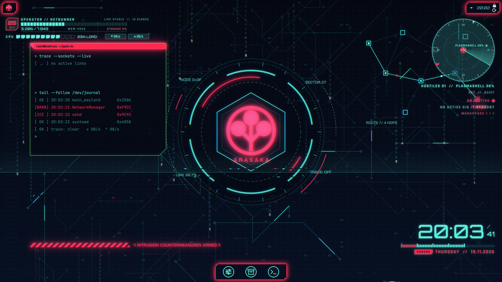

CyberNeon started on Budgie, and [that edition](https://github.com/AlanNappi/Budgy-Cyberneon) is still what I use today. My next laptop will run KDE, so the plan was a straight port. Then I changed my mind. Plasma gives you GPU blur, window decorations written in QML and shaders inside the compositor, and it felt like a waste to use all that just to rebuild the same desktop.

So this edition keeps the colors (midnight blue, neon red, cyan) and redraws everything else as a video game HUD. Your vitals sit top left, the radar and the current objective top right, the dock works like a row of quick slots, and a counter in the corner ticks down the minute the way an ammo counter would.

The one thing I kept identical is the animated wallpaper. I like it too much to touch it.

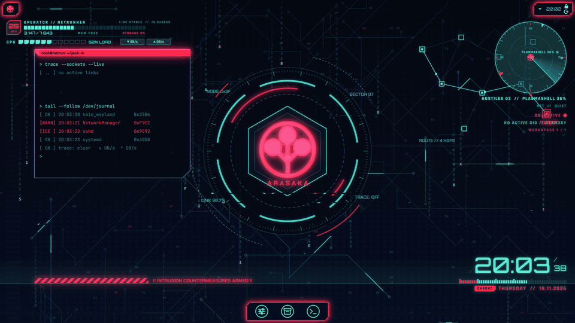

The desktop also pays attention to what your PC is doing. Push the CPU hard and it goes into alert, the terminal on the wallpaper shows your real connections (with the addresses scrambled), and volume changes appear as a quickhack upload. That part has [its own section](#a-desktop-that-reacts).

> **Where it stands.** So far it has only run in the Docker lab included in this repo (Plasma 6.8.3 on Arch Linux, Wayland). The desktop screenshots come from there, which is why the Biomonitor says NETRUNNER: on your PC it shows your user name. It hasn't been on a real laptop yet, and [this list](#what-i-havent-tested-yet) says exactly what that leaves unproven.

---

## Table of Contents

- [The HUD, zone by zone](#the-hud-zone-by-zone)
- [A desktop that reacts](#a-desktop-that-reacts)
- [What's included](#whats-included)
- [Screenshots](#screenshots)
- [Requirements](#requirements)
- [Installation](#installation)
- [Configuration (`cyberneon.conf`)](#configuration-cyberneonconf)
- [Changing the logo](#changing-the-logo)
- [What `install.sh` actually does](#what-installsh-actually-does)
- [Login screen and GRUB (optional)](#login-screen-and-grub-optional)
- [Checking that it worked](#checking-that-it-worked)
- [Trying it without a KDE machine](#trying-it-without-a-kde-machine)
- [What I haven't tested yet](#what-i-havent-tested-yet)
- [Uninstalling](#uninstalling)
- [Repository layout](#repository-layout)
- [Customizing](#customizing)
- [Technical notes](#technical-notes)
- [Credits, trademarks and licenses](#credits-trademarks-and-licenses)

---

## The HUD, zone by zone

The in-game HUD keeps each kind of information in a fixed spot, and UX write-ups of it describe those zones pretty clearly (links [at the end of the credits](#references-for-the-hud-layout)). I took that organization and nothing else. Every element here is drawn from scratch and shows real data from your machine.

| Zone | In the game | In CyberNeon |
|---|---|---|
| Top left | health, level, resources | A floating panel with the logo (opens your apps) and the virtual desktops, plus the **Biomonitor**. Its "level" badge is your uptime in hours, the segmented bar is free RAM, the blocks are free CPU, then disk, network and your name. |
| Top right | minimap with the time, active quest | A floating panel with tray, clock and lock/logout, plus the **threat radar**: programs that weigh on your PC are contacts, the heavier the closer to the center, arrows on the rim are programs moving data and red diamonds are intrusions ([details](#threat-radar)). Below it, the objective tracker treats the active window as your objective and the other open windows as sub-objectives. |
| Bottom center | ability slots | A floating dock sized to its icons, with chamfered slots. The active one becomes a cyan plate. |
| Bottom right | ammo counter | The **Chrono**. The time is the counter, the seconds left are the reserve, and 60 notches empty out over the minute, with the last ten in red. It glitches every 12 seconds, or every 2.5 during an alert. |
| Bottom left | messages and calls | Notifications land here, on glass with a red border. |

## A desktop that reacts

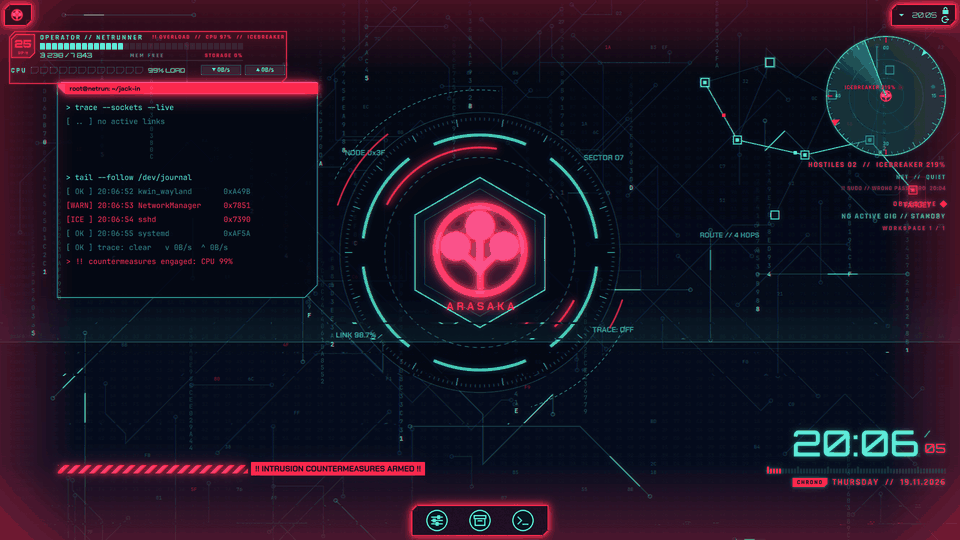

<sub>Alert mode under a real CPU load, captured in the lab.</sub>

| | |
|---|---|
| 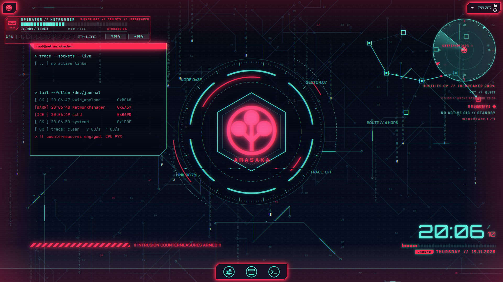 **Alert mode** |  **Live terminal** on the wallpaper |
| 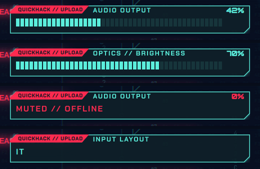 **Quickhack OSD** | 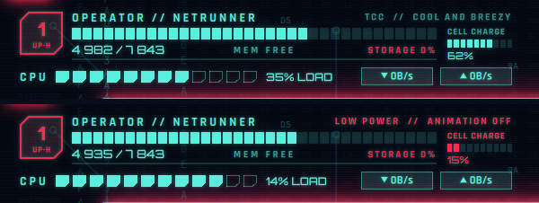 **CELL CHARGE** and TUXEDO profile (both simulated in the lab) |

### Threat radar

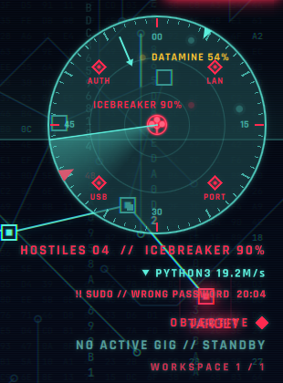

In the game the minimap tells you who's around and how dangerous they are. Here the enemies are whatever slows your PC down, uses your network or tries to get in.

- **Contacts.** Every program with a real load is a dot, and all the processes of one program count as one, so Firefox's twenty processes are a single contact. The closer to the center, the heavier: a whole CPU core or 30% of the RAM puts it in the red. Bigger dots use more memory, the sweep lights them up as it passes, and the yellow and red ones carry their name and load, like `FIREFOX 92%`. When nothing heavy is running the radar is empty and says `ZONE CLEAR`.
- **Traffic.** A program downloading gets an arrow pointing in, one uploading an arrow pointing out, and the faster it goes the longer the arrow. The line under the radar names the top downloader and uploader.
- **Sentinel.** A red diamond with a short tag (`USB`, `AUTH`, `SSH`, `PORT`, `LAN`) blinks on the rim for a minute and the line under the radar says what happened and when: a USB device plugged in (a stick that also declares a keyboard is reported as a keyboard, the "BadUSB" trick), a wrong password for sudo, su, the lock screen or the login screen, an SSH login or a failed one, a program opening a port to the network, a device showing up on your network for the first time.
- **The alert names the culprit**, see below.
- **Quickhack.** Click a contact and a panel opens with two quickhacks: **OVERLOAD** closes the program the normal way, so a browser still saves its session, and **FLATLINE** kills every process of it, losing unsaved work. Nothing happens until you press **UPLOAD** to confirm, then an upload bar fills and the program goes down. The desktop session itself (window manager, panel, sound, the HUD) and other users' processes show up as **PROTECTED** and can't be touched. `QUICKHACK="no"` turns it off.

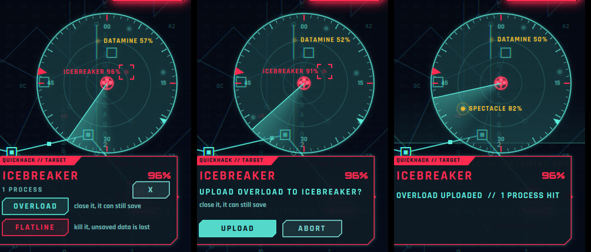

The dial still tells the time: a red notch for the hour, a cyan one for the minute, the sweep does the seconds. Only program names appear. The login lines are read from the system journal (your user has to be allowed to: groups `adm`, `wheel` or `systemd-journal`) but never shown, and the devices the radar has met are stored as salted hashes. `SENTINEL="no"` turns the intrusion part off.

### Alert mode

If the CPU or the RAM goes over 85%, or the CPU or GPU reaches 95 °C, and it stays there for 3 seconds, the desktop starts to panic. The Biomonitor frame pulses red and its status line tells you why and who's to blame (`!! OVERLOAD // CPU 97% // FIREFOX`). `INTRUSION COUNTERMEASURES ARMED` flashes on the wallpaper and the screen edges turn red. The wallpaper glitches every second or two instead of every 7 to 14, and new windows open with a stronger, longer glitch.

It ends after 6 seconds of calm. There's a margin so it doesn't flicker on and off around the limit: CPU has to drop 10 points below its threshold, RAM and temperature 5.

RAM usage leaves out the page cache, otherwise a PC that has simply been on for a while would be in permanent alert. A long compile will set it off, and that's the fun of it. If it gets on your nerves, raise `ALERT_CPU` or set `REACTIVE_HUD="no"`.

### The terminal on the wallpaper

The `root@netrun:~/jack-in` window used to play a fixed script. Now it lists your active network connections and the latest journal activity, in the same style, every 5 seconds. When traffic goes over 5 MB/s in either direction, `[WARN] trace program active` appears with a timer. Docker, bridges and VPN tunnels are left out of that count, so the same bytes don't get counted twice.

Since this ends up on your wallpaper, and sooner or later in a screenshot, I kept it careful:

- IP addresses never appear. Each one becomes a short tag that changes at every boot.
- Journal messages are never shown, only time, priority and program name.
- Program names **are** visible. If you'd rather not show them, set `LIVE_TERMINAL="no"`.
- The lock screen, the login screen and the splash keep the original fake log and show no real data.

### Quickhack OSD

Volume, microphone, brightness, keyboard backlight, keyboard layout, touchpad, Wi-Fi, Bluetooth and power profile changes all show up as an upload bar above the dock, in place of Plasma's OSD.

The bar lives inside the Biomonitor widget. If you remove that widget, set `CYBER_OSD="no"` and run `./install.sh` again, or you'll be left with no OSD at all. The installer keeps Plasma's own OSD when `busctl` is missing, when the session bus can't be monitored, or when you use `--no-layout` and the Biomonitor isn't on your desktop.

### Sounds

These are off by default, because not everybody wants a desktop that chirps. Set `SOUND_FX="yes"` and run `./install.sh` again. They're synthesized from nothing by `scripts/make_sounds.py`, using only the Python standard library, so there are no samples and nothing from the game. You can listen to them right here:

| Sound | When it plays | Length |
|---|---|---|
| [`message-new-instant`](docs/sounds/message-new-instant.wav) | a notification arrives, the low INCOMING CALL // FIXER chirp | 0.33 s |
| [`dialog-warning`](docs/sounds/dialog-warning.wav) | alert mode starts | 0.56 s |
| [`desktop-login`](docs/sounds/desktop-login.wav) | jack-in, when your session starts | 1.50 s |
| [`dialog-error`](docs/sounds/dialog-error.wav) | apps that use the system sound theme | 0.37 s |
| [`dialog-information`](docs/sounds/dialog-information.wav) | same | 0.12 s |
| [`device-added`](docs/sounds/device-added.wav) | same | 0.16 s |
| [`device-removed`](docs/sounds/device-removed.wav) | same | 0.16 s |
| [`audio-volume-change`](docs/sounds/audio-volume-change.wav) | same | 0.04 s |

`service-login` is a copy of `desktop-login`. The notification chirp respects Do Not Disturb and plays at most once every 2 seconds. The login screen itself stays silent, because your user's audio server isn't running yet at that point, so the jack-in plays right after you log in.

### Battery

On any machine with a battery the Biomonitor gains a **CELL CHARGE** gauge. When you're unplugged and below 20%, the wallpaper stops moving, the radar drops to one update per second, the wallpaper terminal stops refreshing and the status line says `LOW POWER // ANIMATION OFF`. Everything comes back when you plug in. `LOW_POWER_PERCENT` changes the threshold, and `0` turns this off.

### TUXEDO Control Center

If the TUXEDO Control Center is running, the Biomonitor status line shows the active profile (`TCC // COOL AND BREEZY`). It only reads the profile name and never changes anything. On any other PC nothing appears and nothing else happens.

## What's included

| Component | Description |
|---|---|
| **`CyberNeon Live` wallpaper** | The same one as the Budgie edition: scanline, arcs rotating around the seal, blinking network nodes, a pulsing target, data packets, hex columns and glitches that shift slices of the image. A single QML component drives the desktop, login, splash and lock screen. `ANIMATED_WALLPAPER="no"` gives you a static image. |
| **Window frames** | A QML decoration: dark titlebar inside a red neon tube, a big 45° cut top left and a small one bottom right, and a glow blurred by the GPU around the window. When a window gets focus the glow flickers on and a cyan wave runs across the titlebar. |
| **Glass panels and popups** | Floating panels, menus and notifications in blurred glass with chamfered corners. The neon glow is drawn by KWin as a shadow, so it follows the 45° cuts too. |
| **HUD widgets** | Biomonitor, Radar with objective tracker, and Chrono. |
| **Reactive HUD** | Alert mode, live terminal, Quickhack OSD, optional sounds, battery gauge and TUXEDO profile ([details](#a-desktop-that-reacts)). |
| **Window glitch** | A KWin effect with a GLSL fragment shader. Opening or closing a window splits it into red and cyan, breaks it into shifted slices with scanlines, and puts it back together in about 0.4 seconds. Without shader support it falls back to a flicker and a sideways jolt. |
| **Alt+Tab "target lock"** | Live previews in chamfered cards. The selected window gets a thick red frame, corner brackets and a TARGET tag. |
| **Qt apps** | A Kvantum theme turns Dolphin, System Settings and the rest into blurred glass with chamfered buttons, red menus and striped progress bars. Konsole gets its own translucent profile. |
| **Splash, login, lock screen** | A `// JACKING IN` splash where the wallpaper seal lights up, an SDDM login terminal over the animated wallpaper, and the Plasma lock screen on the same wallpaper. |
| **Everything else** | Ringed icons plus Papirus-Dark with "cyber" folders, HUD cursors, Chakra Petch, Rajdhani and Orbitron fonts, a red and cyan bash prompt, a GTK theme and a GRUB theme. |

## Screenshots

| | |
|---|---|
|  **Neon frames** and Qt apps in glass | 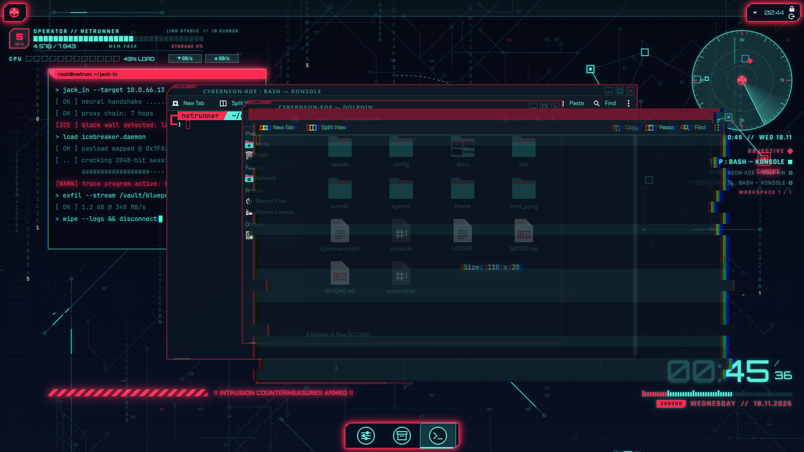 **Window glitch**, slowed down to catch it |
|  **Alt+Tab**, from KWin's preview tool with sample windows | 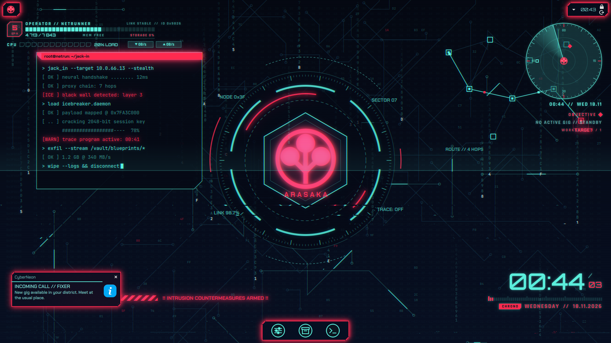 **Notifications**, bottom left like incoming calls |
|  **Lock screen** on the animated wallpaper | 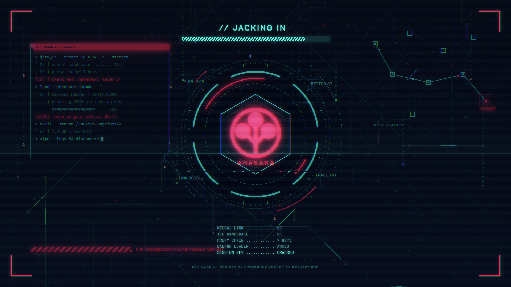 **Jack-in splash** |
|  **SDDM login** | 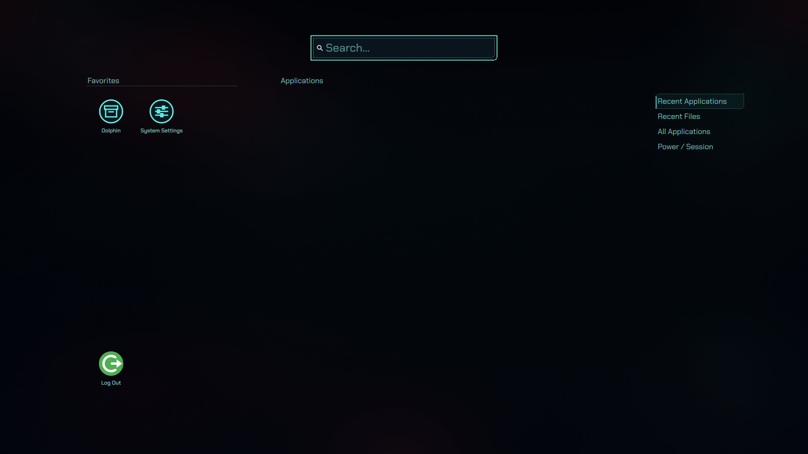 **Launcher**, full screen and blurred |
|  **Wallpaper** | 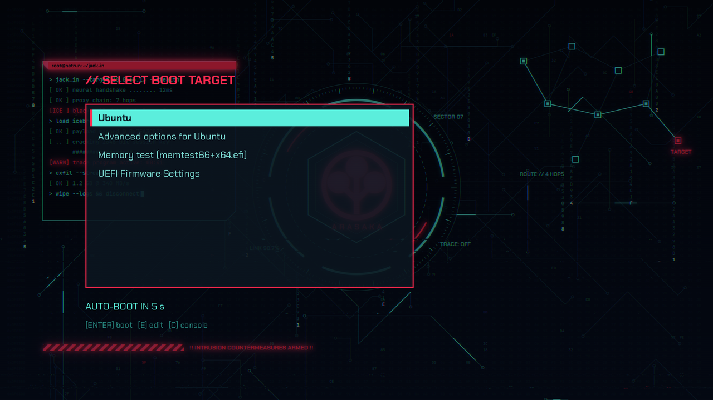 **GRUB menu** (rendered preview) |

The animated wallpaper on its own:


**Icons**, the custom launchers and the recolored Papirus-Dark folders:

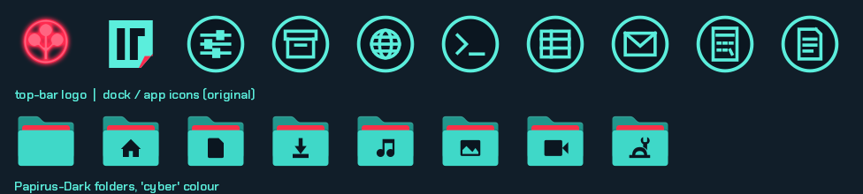

**Cursors** on light and dark backgrounds:

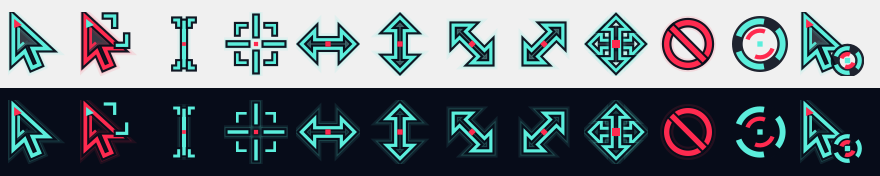

**Bash prompt**, shared with the Budgie edition (that's where this preview comes from):

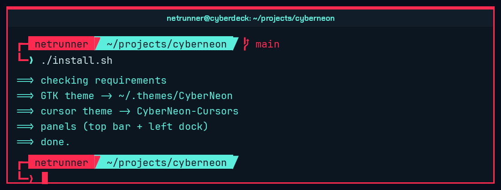

> The screenshots use the default setup with the Arasaka logo (© CD PROJEKT S.A.). With `LOGO=""` you get the original CyberNeon emblem instead.

## Requirements

- **KDE Plasma 6** on any distro (KDE neon, Kubuntu, Fedora KDE, Arch, openSUSE and so on), with OpenGL. Any graphics card from the last several years should be fine.
- A **Wayland** session is what I've tested. X11 is supported by the code but [hasn't been tried yet](#what-i-havent-tested-yet).
- `python3` with Pillow and pycairo, plus `curl`.
- Recommended: **Kvantum** for the glass Qt apps, **kdeplasma-addons** for the full-screen launcher, and **JetBrainsMono Nerd Font** for the prompt and the wallpaper terminal.

  ```bash
  sudo apt install python3-pil python3-cairo curl qt6-style-kvantum kdeplasma-addons-data   # Debian, Ubuntu, Kubuntu, neon
  sudo dnf install python3-pillow python3-cairo curl kvantum kdeplasma-addons               # Fedora
  sudo pacman -S python-pillow python-cairo curl kvantum kdeplasma-addons                   # Arch
  ```

  Package names change a bit between distros. Without Kvantum, Qt apps use Breeze with the CyberNeon colors and Dolphin gets its transparency from a KWin rule. Without kdeplasma-addons the launcher falls back to Kicker or Kickoff.
- For the reactive parts: `busctl` (systemd) for the OSD, `ss` (iproute2) for the live terminal, and `pw-play` or `paplay` for the sounds.
- For the GRUB theme: `grub-mkfont` or `grub2-mkfont`.
- An internet connection the first time, to download Papirus (about 33 MB).

## Installation

```bash
git clone https://github.com/AlanNappi/KDE-Cyberneon.git cyberneon-kde
cd cyberneon-kde
./install.sh
```

> **Read this first:** unless you pass `--no-layout`, the installer **replaces your current panels** with the CyberNeon HUD. Your old setup is saved in a backup and `uninstall.sh` brings it back.

| Flag | Effect |
|---|---|
| `--no-layout` | Leaves your panels and widgets alone. Themes, colors, icons, cursors, fonts, window frames, effects, Kvantum, Konsole and the prompt are still applied. |
| `--skip-papirus` | Doesn't download Papirus. |
| `-h` | Shows the help. |

It all happens at user level, no `sudo` needed. When it finishes, log out and back in so that everything starts clean. If you change something in `cyberneon.conf` later, just run `./install.sh` again.

## Configuration (`cyberneon.conf`)

`install.sh` reads this file, which is plain bash. Relative paths start from the repo folder.

| Variable | Default | What it does |
|---|---|---|
| `LOGO` | `assets/logo/arasaka-logo.webp` | Image for the center of the wallpaper, the launcher badge and the radar, tinted neon red. Empty means the original CyberNeon emblem. |
| `LABEL` | `A R A S A K A` | Text under the wallpaper seal. |
| `HUD_LABEL` | *(empty)* | Name shown on the Biomonitor. Empty means your user name in capitals. |
| `WALLPAPER` | `cyberneon-arasaka-red.png` | File created in `~/Pictures/Wallpapers`. |
| `DECORATION` | `qml` | Window frames: `qml` (glow and animations) or `svg` (simpler Aurorae theme). |
| `ANIMATED_WALLPAPER` | `yes` | Animated wallpaper, lock screen included. `no` gives a static image. |
| `GLITCH_EFFECT` | `yes` | GPU glitch when windows open and close. |
| `REACTIVE_HUD` | `yes` | Alert mode based on real load. |
| `ALERT_CPU` | `85` | CPU percentage that triggers the alert. |
| `ALERT_RAM` | `85` | RAM percentage, page cache excluded. |
| `ALERT_TEMP` | `95` | Temperature in °C, the hotter of CPU and GPU. |
| `LIVE_TERMINAL` | `yes` | Real, scrambled data in the wallpaper terminal. |
| `TRACE_MBPS` | `5` | MB/s of traffic that prints `trace program active`. |
| `SENTINEL` | `yes` | The radar also flags intrusions: USB devices, wrong passwords, SSH logins, new open ports, new devices on your network. |
| `QUICKHACK` | `yes` | A click on a radar contact can close that program, after a confirmation. |
| `CYBER_OSD` | `yes` | Quickhack OSD instead of Plasma's. |
| `SOUND_FX` | `no` | Sound theme and jack-in at session start. |
| `LOW_POWER_PERCENT` | `20` | Battery level below which animations stop. `0` means never. |
| `DOLPHIN_OPACITY` | `90` | Dolphin opacity, used only without Kvantum. |
| `PINNED` | settings, file manager, browser, Konsole, Calc | Dock launchers, in Plasma's syntax. Missing apps are skipped. |
| `UI_FONT`, `FIXED_FONT`, `TITLE_FONT` | Chakra Petch 10, JetBrainsMono Nerd Font 10, Chakra Petch Bold 10 | Fonts, as Qt font strings. |

## Changing the logo

The repo ships with `assets/logo/arasaka-logo.webp`, which belongs to **CD PROJEKT S.A.** and is included only as a non-commercial fan tribute, following [CD PROJEKT RED's fan content guidelines](https://www.cdprojektred.com/en/fan-content). The installer tints it neon red and puts it in the wallpaper seal, on the launcher badge and in the middle of the radar.

To use your own:

1. Put a PNG or WebP with a transparent background in `assets/logo/`.
2. Update `LOGO=` and `LABEL=` in `cyberneon.conf`.
3. Run `./install.sh` again.

With `LOGO=""` you get the original CyberNeon emblem.

## What `install.sh` actually does

1. **Checks** for Plasma 6, the tools it needs and Python, then reads the logical width of the main screen with `kscreen-doctor`.
2. **Backs up** `kdeglobals`, `kwinrc`, `kwinrulesrc`, `plasmarc`, `plasmashellrc`, the applets file, `kcminputrc`, `konsolerc`, `ksplashrc`, `kscreenlockerrc`, `plasmanotifyrc`, the GTK settings, the Kvantum config and `~/.bashrc` into `~/.local/share/cyberneon/backups/<timestamp>/`. The very first backup is also copied to `backups/pristine/`, and that's the one `uninstall.sh` restores.
3. **Installs** the fonts, Papirus, the GTK theme (built from `third_party/Pocillo-dark`), the icons and the cursors.
4. **Generates** the wallpaper and the login and GRUB assets.
5. **Builds the KDE themes**: color scheme, glass Plasma theme and QML window frames.
6. **Applies Kvantum**, if you have it.
7. **Sets up** the animated wallpaper, global theme and splash, lock screen, Alt+Tab and the glitch effect, and turns on KWin's blur and contrast.
8. **Configures** Konsole, GTK and the bash prompt, and adds the Dolphin transparency rule if Kvantum is missing.
9. **Installs** the HUD widgets and the helper scripts in `~/.local/share/cyberneon/bin`, moves notifications to the bottom left, turns off Plasma's OSD if the Quickhack one can run, and adds the sound theme if you asked for it.
10. **Builds the layout** from `kde/layout.js`: three floating panels, wallpaper, Biomonitor, Radar and Chrono.
11. **Reloads** KWin and restarts plasmashell.

## Login screen and GRUB (optional)

You don't need these for the desktop theme, and they're the only parts that touch the system. Run `./install.sh` once as your normal user first, because it prepares their files.

```bash
sudo bash system/install-sddm.sh   # SDDM theme on the animated wallpaper
sudo bash system/install-grub.sh   # GRUB theme, menu visible for 5 seconds
```

**SDDM.** The script copies the theme to `/usr/share/sddm/themes/cyberneon`, along with the cursors and fonts, and writes `/etc/sddm.conf.d/10-cyberneon.conf`.

- Preview it without logging out: `sddm-greeter-qt6 --test-mode --theme /usr/share/sddm/themes/cyberneon`
- Undo: `sudo rm /etc/sddm.conf.d/10-cyberneon.conf`

**GRUB.** The script installs the theme to `/boot/grub/themes/cyberneon`, saves your config as `/etc/default/grub.bak-cyberneon`, sets `GRUB_THEME`, `GRUB_TIMEOUT_STYLE=menu`, `GRUB_TIMEOUT=5` and `GRUB_GFXMODE=1920x1080,auto`, then runs `update-grub`. On Fedora and openSUSE, finish with `sudo grub2-mkconfig -o /boot/grub2/grub.cfg`.

- Undo: `sudo cp /etc/default/grub.bak-cyberneon /etc/default/grub`, then regenerate the GRUB config.

## Checking that it worked

1. `./install.sh` finishes and the layout step prints `panels <id> <id> <id>`.
2. You see the logo and Biomonitor top left, tray, clock and Radar top right, the dock at the bottom and the Chrono bottom right.
3. The wallpaper moves and glitches every so often.
4. Windows have the red glow, and it flickers back on when you click them.
5. Opening and closing a window gives the red and cyan glitch.
6. Alt+Tab shows preview cards with a red TARGET on the selected window.
7. Meta+L shows the animated wallpaper with the original terminal text.
8. Changing the volume brings up the Quickhack bar above the dock.
9. A heavy job, like a compile, starts alert mode after a few seconds.

If something's off, start with `journalctl --user -b | grep -iE "cyberneon|qml"`. To see QML errors from a terminal you need `QT_FORCE_STDERR_LOGGING=1`.

## Trying it without a KDE machine

I'm still on Budgie, so I built a lab to work on this. `lab/` holds a Docker setup with Arch Linux and Plasma 6, running headless with KWin in virtual mode and OpenGL on your GPU's render node. It runs the real `install.sh`, takes real screenshots and leaves your system alone.

```bash
bash lab/run-lab.sh            # full run, about 2 GB to download the first time
bash lab/run-lab.sh reactive   # only the reactive HUD
```

You need Docker, with your user in the `docker` group. Everything ends up in `lab/out/`: numbered screenshots, frames for the GIFs, `install.log`, `effects.txt`, `qmllint.txt` and `plasmashell-errors.txt`.

The reactive run puts a real load on the CPU and streams real traffic from a second container. Battery and TUXEDO Control Center are simulated on a private bus. The journal contains a test message marked as secret, to confirm it never reaches the screen. The radar gets named CPU loads, a fake USB keyboard, a wrong sudo password in a fake journal and a server opening a port, then quickhacks a test program (a lab-only hook clicks for it, since a headless Wayland has no mouse). Results are in `alert.txt`, `mocks.txt`, `radar.txt` and `reactive.txt`.

## What I haven't tested yet

A container only proves so much. These are still open, and if you try any of them I'd like to know how it went:

- **Real hardware.** Nothing has run on a physical KDE machine yet.
- **X11.** The lab uses Wayland only.
- **Battery.** The gauge and the power saving were tested against a simulated battery.
- **TUXEDO Control Center.** Also simulated. I don't know yet whether the real service lets a normal user read the profile. If it doesn't, the profile just won't appear.
- **Volume and brightness keys.** The OSD was tested by sending Plasma the same D-Bus calls the keys trigger, not by pressing real keys.
- **Sounds.** They fire at the right moments, but in the lab the audio player is a stub. I still have to sit down and listen to them properly.
- **`uninstall.sh`, `--no-layout`, `install-sddm.sh` and `install-grub.sh`.** The lab doesn't run these. The SDDM theme itself was checked in test mode.
- **Other distros.** Plasma 6 elsewhere should behave the same, but I've only seen it on Arch.

## Uninstalling

```bash
./uninstall.sh          # restores your previous KDE and GTK settings and removes the CyberNeon files
./uninstall.sh --purge  # also removes the CyberNeon fonts and Papirus
```

It puts back the settings from `backups/pristine/`, removes themes, widgets, effects, scripts, sounds and the prompt block in `~/.bashrc`, gives you Plasma's OSD back and reloads KWin and Plasma. Your wallpapers and backups stay where they are. Log out and back in afterwards. SDDM and GRUB have their own undo commands, listed [above](#login-screen-and-grub-optional).

## Repository layout

```
cyberneon-kde/
├── install.sh / uninstall.sh      install and restore
├── cyberneon.conf                 configuration
├── kde/
│   ├── shared/                    animated wallpaper, load and battery state, QML settings
│   ├── bin/                       helper scripts: threat radar, bus watcher, live terminal, sounds, TUXEDO
│   ├── layout.js                  HUD layout: panels, widgets, wallpaper
│   ├── decoration/cyberneon/      QML window frames
│   ├── wallpaper/                 animated wallpaper plugin
│   ├── lookandfeel/               global theme and jack-in splash
│   ├── effects/cyberneon_glitch/  window glitch (JavaScript and GLSL)
│   ├── tabbox/cyberneon/          Alt+Tab "target lock"
│   ├── plasmoids/                 Biomonitor, Radar, Chrono
│   ├── konsole/                   Konsole palette and profile
│   └── sddm/cyberneon/            SDDM theme
├── scripts/
│   ├── make_kde_themes.py         Plasma theme, SVG frames, color scheme
│   ├── make_kvantum.py            Kvantum theme
│   ├── build_theme.py             GTK theme
│   ├── make_sounds.py             sound theme (standard library only)
│   ├── make_wallpaper.py          4K wallpaper
│   ├── make_icons.py, make_logo_icon.py, make_cursors.py, make_system_assets.py
│   └── install_fonts.sh, install_papirus.sh
├── lab/                           Docker test lab
├── theme/, config/, system/       GTK CSS, bash prompt, SDDM and GRUB installers
├── third_party/Pocillo-dark/      base of the GTK theme (GPL-2.0)
├── assets/                        fonts (OFL) and Arasaka logo (© CD PROJEKT S.A.)
└── docs/                          screenshots, GIFs and sounds
```

## Customizing

**Colors**

| Role | Hex |
|---|---|
| Neon red | `#ff2a4f` |
| Dark red (inactive frames) | `#8c1a33` |
| Cyan | `#5beedc` |
| Panel blue | `#111e29` |
| Field and view blue | `#0b1620` |
| Deep desktop blue | `#070d1a` |

They're defined at the top of `scripts/make_kde_themes.py` and `make_kvantum.py`, in the QML files and in the GTK CSS, so a palette change means touching all of them.

**Where to look for the rest**

| To change | Go to |
|---|---|
| Wallpaper speed and objects | `kde/shared/CyberNeonLive.qml` (coordinates are for a 3840×2160 image) |
| Glow size, titlebar height, corner cut | top of `kde/decoration/cyberneon/contents/ui/main.qml` |
| Glitch strength | `kde/effects/cyberneon_glitch/contents/shaders/glitch_core.frag` |
| Glitch timing | `kde/effects/cyberneon_glitch/contents/code/main.js` |
| Widgets | `kde/plasmoids/org.cyberneon.*/contents/ui/main.qml` |
| Widget positions | `kde/layout.js` |
| Alert timing | `kde/shared/CyberNeonReactor.qml` |
| Sounds | `scripts/make_sounds.py` |
| Panel glass and glow | `glass_frame()` and `glow_shadow()` in `scripts/make_kde_themes.py` |

## Technical notes

Some of this took a while to figure out, so I'm leaving it here in case you're building something for Plasma too.

- **Window glow.** QML decorations have a `padding` area that KWin turns into the window shadow. The glow is drawn there with `MultiEffect`, so it can't be clicked and it disappears on maximized windows.
- **Panel and popup glow.** It comes from the Plasma theme's `shadow-*` elements. Their `shadow-hint-*-margin` values are smaller than the images, so the shadow slides a few pixels under the window and follows the 45° cuts. The blur behind the glass uses `mask-*` elements with the same shape.
- **Shaders in JavaScript KWin effects.** You load them with `effect.addFragmentShader(Effect.MapTexture | Effect.Modulate, "file.frag")` from `contents/shaders/`, and animate them with `{type: Effect.ShaderUniform, fragmentShader: id, uniform: "name"}`. OpenGL core needs `#version 140`, and there's a 1.10 version as well.
- **Config in KWin effects.** `effect.readConfig` only sees keys declared in `contents/config/main.xml`. Without that file the alert flag always came back false.
- **Disabling the OSD.** With `[OSD] Enabled=false` in `plasmarc`, Plasma hides its OSD and also stops emitting `osdProgress` and `osdText`, the signals I had planned to listen to. The method calls to `org.kde.osdService` still go through, so `busctl --user monitor` can read them.
- **No streaming processes in QML.** `cn-bus-watch` works as a long poll, with two overlapping waits so that no event falls between one poll and the next. The radar's login events work the same way (`cn-threats --auth`), and the scan keeps what it compares with in a small file under `$XDG_RUNTIME_DIR`, since every run is a new process.
- **One radar for two desktops.** `bin/cn-threats` is the same file the Budgie edition imports. Per-program traffic comes from the kernel's TCP byte counters (`ss -i`), read only when the network moves more than 16 KB/s. QUIC has no counters, so the leftover traffic goes to the program holding UDP sockets on port 443. Memory is resident minus shared, otherwise twenty Firefox processes would count the same libraries twenty times.
- **OSD windows from a widget.** A `PlasmaCore.Dialog` with no `visualParent` loses its position when it's shown again. Anchoring it to an item on the desktop fixes that.
- **Sneaky QML names.** A property called `onSomething` gets read as a signal handler, and `state` already exists on `Item`. Both give you wrong values with no error. A property called `left` in a `PlasmoidItem` is worse, because the widget refuses to load ("Cannot override FINAL property").
- **`parent` inside `ShapePath`.** It doesn't point to the `Shape`. Use an `id`.
- **Floating panels on one edge.** With `lengthMode = "fit"` and different alignments, two of them fit on the same row.
- **Testing Alt+Tab.** `/usr/lib/kwin-tabbox-preview <path>/contents/ui/main.qml` runs the switcher without a keyboard.
- **Lock screen and OSD in Plasma 6.8.** The global theme can't restyle them anymore. The lock screen uses the wallpaper plugin, which is why it can be animated, and takes fields and buttons from the Plasma theme.
- **Packaging.** `kpackagetool6` refuses `KWin/Decoration` packages, so the frames are copied to `~/.local/share/kwin/decorations/`. KWin effects copied while KWin is running only load at the next login, so the installer loads them through D-Bus.

## Credits, trademarks and licenses

**CD PROJEKT RED and *Cyberpunk 2077***

- CyberNeon is an **unofficial, non-commercial fan project**, made by a huge fan as a tribute to their work.
- The netrunner imagery, the red and cyan palette, the angular interfaces and the atmosphere that inspired it are creations of **CD PROJEKT RED**.
- *Cyberpunk 2077*, *Arasaka*, *Night City* and all related names, logos and trademarks are registered trademarks and/or protected works of **CD PROJEKT S.A.**
- This project is **not affiliated with, sponsored or endorsed by** CD PROJEKT RED or CD PROJEKT S.A.
- Wallpaper, icons, cursors, emblem, widgets, window frames and sounds are generated by the code in this repo, written with the help of AI tools. No art, fonts or audio were extracted from the game.
- The only CD PROJEKT RED element included is the **Arasaka logo** (`assets/logo/arasaka-logo.webp`), along with the name in `LABEL`. They're used as a fan tribute under the [fan content guidelines](https://www.cdprojektred.com/en/fan-content) and are not covered by this repository's license.
- If CD PROJEKT RED asks for anything to be changed or removed, I'll do it right away.
- If you like this theme, go play the game and support the people who made it.

**Third-party components**

- **Pocillo-dark** (Ubuntu Budgie, `ubuntu-budgie-themes` 0.19.0, GPL-2.0): included in `third_party/` with its license. The generated GTK theme is a GPL-2.0 derivative.
- **Papirus icon theme** (GPL-3.0): downloaded during installation, not included.
- **Chakra Petch**, **Rajdhani**, **Orbitron**: SIL Open Font License 1.1, included with their licenses.
- **KDE Plasma**, **KWin**, **Konsole**, **Dolphin**, **SDDM**: used as they are.

**License of this repository**: GPL-2.0 (see `LICENSE`), except for the third-party components and trademarks listed above.

### References for the HUD layout

The zones are based on these public analyses of the *Cyberpunk 2077* interface, whose original design is by CD PROJEKT RED:

- [A UX analysis of Cyberpunk 2077's HUD (Medium / Super Jump)](https://medium.com/super-jump/a-ux-analysis-of-cyberpunk-2077s-hud-f74afe6b9961)
- [Cyberpunk 2077 UX/UI critique (Interface In Game)](https://interfaceingame.com/articles/cyberpunk-2077-ux-ui-critique)
- [Cyberpunk 2077 UX analysis (trashbox.ru)](https://trashbox.ru/link/cyberpunk-2077-ux-analysis)
- [Cyberpunk 2077 (HUDS+GUIS)](https://www.hudsandguis.com/home/2019/cyberpunk-2077)

---
---

<a name="italiano"></a>

# CyberNeon per KDE Plasma 6

> **Progetto fan made.** CyberNeon è non ufficiale e non commerciale. L'ho fatto perché sono un grandissimo fan di *Cyberpunk 2077* e di **CD PROJEKT RED**, che ha creato il mondo, lo stile e l'atmosfera a cui questo tema si ispira. *Cyberpunk 2077*, *Arasaka* e tutti i nomi e i loghi collegati appartengono a **CD PROJEKT S.A.**, compreso il logo Arasaka in `assets/logo/`. Il progetto non è affiliato né approvato da CD PROJEKT RED. Trovi il resto nei [Crediti](#crediti-marchi-e-licenze) e in [`NOTICE.md`](NOTICE.md).


CyberNeon è nato su Budgie, e [quell'edizione](https://github.com/AlanNappi/Budgy-Cyberneon) è ancora quella che uso tutti i giorni. Il prossimo portatile avrà KDE, quindi l'idea era fare un semplice porting. Poi ho cambiato idea. Plasma ti dà la sfocatura via GPU, le cornici delle finestre scritte in QML e gli shader dentro il compositor, e usare tutto questo solo per rifare lo stesso desktop mi sembrava uno spreco.

Così di Budgie sono rimasti i colori (blu notte, rosso neon, ciano) e il resto l'ho ridisegnato come l'HUD di un videogioco. In alto a sinistra ci sono i parametri vitali, in alto a destra il radar e l'obiettivo attuale, la dock fa da barra degli slot rapidi e nell'angolo un contatore consuma il minuto come farebbe con le munizioni.

L'unica cosa rimasta identica è lo sfondo animato. Mi piace troppo per toccarlo.


Il desktop poi tiene d'occhio quello che fa il PC. Se spremi la CPU entra in allerta, il terminale sullo sfondo mostra le tue connessioni vere (con gli indirizzi camuffati) e il volume compare come un quickhack in caricamento. Ne parlo meglio in [una sezione a parte](#un-desktop-che-reagisce).

> **A che punto è.** Per ora ha girato solo nel laboratorio Docker incluso nel repo (Plasma 6.8.3 su Arch Linux, Wayland). Gli screenshot del desktop vengono da lì, ed è per questo che il Biomonitor dice NETRUNNER: sul tuo PC ci sarà il tuo nome utente. Su un portatile vero non c'è ancora stato, e in [questa lista](#cosa-non-ho-ancora-provato) trovi esattamente cosa resta da verificare.

---

## Indice

- [L'HUD, zona per zona](#lhud-zona-per-zona)
- [Un desktop che reagisce](#un-desktop-che-reagisce)
- [Cosa include](#cosa-include)
- [Screenshot](#screenshot)
- [Requisiti](#requisiti)
- [Installazione](#installazione)
- [Configurazione (`cyberneon.conf`)](#configurazione-cyberneonconf)
- [Cambiare il logo](#cambiare-il-logo)
- [Cosa fa davvero `install.sh`](#cosa-fa-davvero-installsh)
- [Login e GRUB (facoltativi)](#login-e-grub-facoltativi)
- [Controllare che abbia funzionato](#controllare-che-abbia-funzionato)
- [Provarlo senza un PC KDE](#provarlo-senza-un-pc-kde)
- [Cosa non ho ancora provato](#cosa-non-ho-ancora-provato)
- [Disinstallazione](#disinstallazione)
- [Struttura del repository](#struttura-del-repository)
- [Personalizzazione](#personalizzazione)
- [Note tecniche](#note-tecniche)
- [Crediti, marchi e licenze](#crediti-marchi-e-licenze)

---

## L'HUD, zona per zona

Nel gioco ogni informazione ha il suo posto fisso, e le analisi UX dell'interfaccia descrivono queste zone abbastanza bene (i link sono [in fondo ai crediti](#riferimenti-per-la-disposizione-dellhud)). Ho ripreso quell'organizzazione e nient'altro: ogni elemento è disegnato da zero e mostra dati veri del tuo PC.

| Zona | Nel gioco | In CyberNeon |
|---|---|---|
| In alto a sinistra | salute, livello, risorse | Un pannello fluttuante con il logo (apre le app) e i desktop virtuali, più il **Biomonitor**. Il badge "livello" sono le ore di accensione, la barra a segmenti è la RAM libera, i blocchi la CPU libera, poi disco, rete e il tuo nome. |
| In alto a destra | minimappa con l'ora, missione attiva | Un pannello fluttuante con area di notifica, orologio e blocco/uscita, più il **radar delle minacce**: i programmi che pesano sul PC sono contatti, più pesano più stanno vicino al centro, le frecce sul bordo sono programmi che muovono dati e i rombi rossi sono intrusioni ([dettagli](#radar-delle-minacce)). Sotto, il tracker considera la finestra attiva il tuo obiettivo e le altre aperte i sotto-obiettivi. |
| In basso al centro | slot delle abilità | Una dock fluttuante grande quanto le sue icone, con gli slot ad angoli tagliati. Quello attivo diventa una piastra ciano. |
| In basso a destra | contatore delle munizioni | Il **Chrono**. L'ora è il contatore, i secondi rimasti sono la riserva e 60 tacche si svuotano durante il minuto, con le ultime dieci in rosso. Fa un glitch ogni 12 secondi, ogni 2,5 durante l'allerta. |
| In basso a sinistra | messaggi e chiamate | Qui arrivano le notifiche, su vetro con il bordo rosso. |

## Un desktop che reagisce


<sub>Modalità allerta con un vero carico sulla CPU, catturata nel laboratorio.</sub>

| | |
|---|---|
|  **Modalità allerta** |  **Terminale live** sullo sfondo |
|  **OSD Quickhack** |  **CELL CHARGE** e profilo TUXEDO (entrambi simulati nel laboratorio) |

### Radar delle minacce


Nel gioco la minimappa ti dice chi hai intorno e quanto è pericoloso. Qui i nemici sono quello che rallenta il PC, usa la tua rete o prova a entrare.

- **Contatti.** Ogni programma con un carico vero è un puntino, e tutti i processi di un programma contano come uno solo: i venti processi di Firefox sono un contatto. Più è vicino al centro, più pesa: un core della CPU intero o il 30% della RAM lo fanno diventare rosso. I puntini più grandi usano più memoria, il fascio li accende quando ci passa sopra, e quelli gialli e rossi hanno accanto nome e carico, tipo `FIREFOX 92%`. Se non gira niente di pesante il radar è vuoto e scrive `ZONE CLEAR`.
- **Traffico.** Un programma che scarica ha una freccia verso il centro, uno che carica una freccia verso fuori, e più va veloce più la freccia è lunga. La riga sotto il radar dice chi scarica e chi carica di più.
- **Sentinella.** Un rombo rosso con una sigla (`USB`, `AUTH`, `SSH`, `PORT`, `LAN`) lampeggia sul bordo per un minuto e la riga sotto il radar dice cosa è successo e a che ora: un dispositivo USB collegato (una chiavetta che si presenta anche come tastiera viene segnalata come tastiera, il trucco delle "BadUSB"), una password sbagliata per sudo, su, il blocco schermo o il login, un accesso SSH riuscito o fallito, un programma che apre una porta verso la rete, un dispositivo che compare per la prima volta nella tua rete.
- **L'allerta dice chi è il colpevole**, vedi sotto.
- **Quickhack.** Clicchi su un contatto e si apre un pannello con due quickhack: **OVERLOAD** chiude il programma nel modo normale, così un browser fa in tempo a salvare la sessione, e **FLATLINE** chiude con la forza tutti i suoi processi, perdendo il lavoro non salvato. Non succede niente finché non premi **UPLOAD** per confermare, poi una barra di upload si riempie e il programma va giù. La sessione del desktop (gestore delle finestre, pannello, audio, l'HUD) e i processi di altri utenti risultano **PROTECTED** e non si toccano. `QUICKHACK="no"` lo spegne.


Il quadrante segna ancora l'ora: una tacca rossa per le ore, una ciano per i minuti, e il fascio fa i secondi. Si vedono solo i nomi dei programmi. Le righe di login le legge dal journal di sistema (il tuo utente deve poterlo fare: gruppi `adm`, `wheel` o `systemd-journal`) ma non le mostra mai, e i dispositivi che il radar ha già visto sono salvati come hash con sale. `SENTINEL="no"` spegne la parte delle intrusioni.

### Modalità allerta

Se CPU o RAM superano l'85%, oppure CPU o GPU arrivano a 95 °C, e la situazione dura 3 secondi, il desktop va in crisi. Il bordo del Biomonitor pulsa di rosso e la riga di stato ti dice il motivo e di chi è la colpa (`!! OVERLOAD // CPU 97% // FIREFOX`). Sullo sfondo lampeggia `INTRUSION COUNTERMEASURES ARMED` e i bordi dello schermo diventano rossi. I glitch dello sfondo arrivano ogni secondo o due invece che ogni 7-14, e le finestre nuove si aprono con un glitch più forte e più lungo.

Finisce dopo 6 secondi di calma. C'è un margine, così non si accende e spegne di continuo attorno al limite: la CPU deve scendere di 10 punti sotto la soglia, RAM e temperatura di 5.

Dalla RAM è esclusa la cache, altrimenti un PC acceso da un po' resterebbe in allerta per sempre. Una compilazione lunga la fa scattare, ed è proprio il bello. Se ti dà fastidio alza `ALERT_CPU` o imposta `REACTIVE_HUD="no"`.

### Il terminale sullo sfondo

La finestra `root@netrun:~/jack-in` prima recitava un copione fisso. Ora elenca le connessioni di rete attive e le ultime attività del journal, con lo stesso aspetto, e si aggiorna ogni 5 secondi. Quando il traffico supera i 5 MB/s, in entrata o in uscita, compare `[WARN] trace program active` con il tempo trascorso. Docker, bridge e tunnel VPN restano fuori dal conteggio, così gli stessi byte non vengono contati due volte.

Visto che questa roba finisce sullo sfondo, e prima o poi in uno screenshot, ci sono andato cauto:

- Gli indirizzi IP non compaiono mai. Ognuno diventa una breve etichetta che cambia a ogni avvio.
- I messaggi del journal non vengono mostrati, solo ora, gravità e nome del programma.
- I nomi dei programmi invece **si vedono**. Se preferisci di no, imposta `LIVE_TERMINAL="no"`.
- Blocco schermo, login e splash tengono il finto log originale e non mostrano nessun dato reale.

### OSD Quickhack

Volume, microfono, luminosità, retroilluminazione della tastiera, layout, touchpad, Wi-Fi, Bluetooth e profilo energetico compaiono come una barra di upload sopra la dock, al posto dell'OSD di Plasma.

La barra vive dentro il widget Biomonitor. Se togli il widget, imposta `CYBER_OSD="no"` e rilancia `./install.sh`, altrimenti resti senza OSD. L'installer lascia quello di Plasma se manca `busctl`, se non riesce a monitorare il bus di sessione, oppure se usi `--no-layout` e il Biomonitor non è sul desktop.

### Suoni

Sono spenti di default, perché non a tutti piace un desktop che cinguetta. Per attivarli imposta `SOUND_FX="yes"` e rilancia `./install.sh`. Li sintetizza da zero `scripts/make_sounds.py` con la sola libreria standard di Python: niente campioni e niente dal gioco. Puoi ascoltarli da qui:

| Suono | Quando parte | Durata |
|---|---|---|
| [`message-new-instant`](docs/sounds/message-new-instant.wav) | arriva una notifica, il chirp basso di INCOMING CALL // FIXER | 0,33 s |
| [`dialog-warning`](docs/sounds/dialog-warning.wav) | inizia la modalità allerta | 0,56 s |
| [`desktop-login`](docs/sounds/desktop-login.wav) | il jack-in, all'avvio della sessione | 1,50 s |
| [`dialog-error`](docs/sounds/dialog-error.wav) | app che usano il tema sonoro di sistema | 0,37 s |
| [`dialog-information`](docs/sounds/dialog-information.wav) | come sopra | 0,12 s |
| [`device-added`](docs/sounds/device-added.wav) | come sopra | 0,16 s |
| [`device-removed`](docs/sounds/device-removed.wav) | come sopra | 0,16 s |
| [`audio-volume-change`](docs/sounds/audio-volume-change.wav) | come sopra | 0,04 s |

`service-login` è una copia di `desktop-login`. Il chirp delle notifiche rispetta "Non disturbare" e parte al massimo una volta ogni 2 secondi. La schermata di login invece resta muta, perché lì il server audio del tuo utente non è ancora partito: il jack-in suona subito dopo l'accesso.

### Batteria

Su qualsiasi PC con una batteria il Biomonitor mostra anche **CELL CHARGE**. Quando sei scollegato e scendi sotto il 20%, lo sfondo si ferma, il radar si aggiorna una volta al secondo, il terminale sullo sfondo non si aggiorna più e la riga di stato dice `LOW POWER // ANIMATION OFF`. Riattacchi l'alimentatore e riparte tutto. La soglia si cambia con `LOW_POWER_PERCENT`, e con `0` la funzione è spenta.

### Il TUXEDO Control Center

Se il TUXEDO Control Center è in esecuzione, la riga di stato del Biomonitor mostra il profilo attivo (`TCC // COOL AND BREEZY`). Legge solo il nome del profilo e non cambia niente. Su tutti gli altri PC non compare nulla e non succede nient'altro.

## Cosa include

| Componente | Descrizione |
|---|---|
| **Sfondo `CyberNeon Live`** | Lo stesso dell'edizione Budgie: linea di scansione, archi che ruotano attorno al sigillo, nodi di rete che lampeggiano, un bersaglio che pulsa, pacchetti di dati, colonne esadecimali e glitch che spostano strisce dell'immagine. Un solo componente QML fa girare desktop, login, splash e blocco schermo. Con `ANIMATED_WALLPAPER="no"` hai un'immagine statica. |
| **Cornici delle finestre** | Una decorazione QML: barra del titolo scura dentro un tubo al neon rosso, un grande taglio a 45° in alto a sinistra e uno piccolo in basso a destra, con un alone sfocato dalla GPU attorno alla finestra. Quando la finestra prende il focus l'alone si accende con un flicker e un'onda ciano attraversa la barra. |
| **Pannelli e popup in vetro** | Pannelli fluttuanti, menu e notifiche in vetro sfocato con gli angoli tagliati. L'alone neon lo disegna KWin come ombra, quindi segue anche i tagli a 45°. |
| **Widget HUD** | Biomonitor, Radar con tracker degli obiettivi e Chrono. |
| **HUD reattivo** | Modalità allerta, terminale live, OSD Quickhack, suoni facoltativi, batteria e profilo TUXEDO ([dettagli](#un-desktop-che-reagisce)). |
| **Glitch delle finestre** | Un effetto KWin con un fragment shader GLSL. Quando apri o chiudi una finestra, questa si sdoppia in rosso e ciano, si spezza in strisce sfalsate con le scanline e si ricompone in circa 0,4 secondi. Senza supporto agli shader ripiega su un flicker e uno scatto laterale. |
| **Alt+Tab "target lock"** | Anteprime dal vivo in schede ad angoli tagliati. La finestra scelta ha una cornice rossa spessa, le staffe agli angoli e l'etichetta TARGET. |
| **App Qt** | Un tema Kvantum trasforma Dolphin, Impostazioni e le altre in vetro sfocato, con pulsanti ad angoli tagliati, menu rossi e barre a strisce. Konsole ha un suo profilo semitrasparente. |
| **Splash, login, blocco schermo** | Una splash `// JACKING IN` in cui si accende il sigillo dello sfondo, un terminale d'accesso SDDM sopra lo sfondo animato e il blocco schermo di Plasma sullo stesso sfondo. |
| **Tutto il resto** | Icone cerchiate più Papirus-Dark con le cartelle "cyber", cursori HUD, font Chakra Petch, Rajdhani e Orbitron, prompt bash rosso e ciano, tema GTK e tema GRUB. |

## Screenshot

| | |
|---|---|
|  **Cornici neon** e app Qt in vetro |  **Glitch delle finestre**, rallentato per riuscire a catturarlo |
|  **Alt+Tab**, dallo strumento di anteprima di KWin con finestre d'esempio |  **Notifiche**, in basso a sinistra come chiamate in arrivo |
|  **Blocco schermo** sullo sfondo animato |  **Splash del jack-in** |
|  **Login SDDM** |  **Lanciatore** a tutto schermo e sfocato |
|  **Sfondo** |  **Menu GRUB** (anteprima renderizzata) |

Lo sfondo animato da solo:


**Icone**, i lanciatori originali e le cartelle Papirus-Dark ricolorate:


**Cursori** su fondo chiaro e scuro:


**Prompt bash**, lo stesso dell'edizione Budgie (l'anteprima arriva da lì):


> Gli screenshot usano la configurazione di default con il logo Arasaka (© CD PROJEKT S.A.). Con `LOGO=""` ottieni invece lo stemma originale di CyberNeon.

## Requisiti

- **KDE Plasma 6** su qualsiasi distribuzione (KDE neon, Kubuntu, Fedora KDE, Arch, openSUSE e così via), con OpenGL. Basta una scheda video degli ultimi anni.
- Una sessione **Wayland** è quello che ho provato. Il codice prevede anche X11, ma [non l'ho ancora testato](#cosa-non-ho-ancora-provato).
- `python3` con Pillow e pycairo, più `curl`.
- Consigliati: **Kvantum** per le app Qt in vetro, **kdeplasma-addons** per il lanciatore a tutto schermo e **JetBrainsMono Nerd Font** per il prompt e il terminale dello sfondo.

  ```bash
  sudo apt install python3-pil python3-cairo curl qt6-style-kvantum kdeplasma-addons-data   # Debian, Ubuntu, Kubuntu, neon
  sudo dnf install python3-pillow python3-cairo curl kvantum kdeplasma-addons               # Fedora
  sudo pacman -S python-pillow python-cairo curl kvantum kdeplasma-addons                   # Arch
  ```

  I nomi dei pacchetti cambiano un po' da una distribuzione all'altra. Senza Kvantum le app Qt usano Breeze con i colori CyberNeon e Dolphin prende la trasparenza da una regola di KWin. Senza kdeplasma-addons il lanciatore ripiega su Kicker o Kickoff.
- Per le parti reattive: `busctl` (systemd) per l'OSD, `ss` (iproute2) per il terminale live, `pw-play` o `paplay` per i suoni.
- Per il tema GRUB: `grub-mkfont` o `grub2-mkfont`.
- Una connessione a Internet la prima volta, per scaricare Papirus (circa 33 MB).

## Installazione

```bash
git clone https://github.com/AlanNappi/KDE-Cyberneon.git cyberneon-kde
cd cyberneon-kde
./install.sh
```

> **Prima leggi qui:** se non passi `--no-layout`, l'installer **sostituisce i tuoi pannelli** con l'HUD di CyberNeon. La configurazione di prima finisce in un backup e `uninstall.sh` la rimette a posto.

| Opzione | Effetto |
|---|---|
| `--no-layout` | Non tocca pannelli e widget. Temi, colori, icone, cursori, font, cornici, effetti, Kvantum, Konsole e prompt vengono applicati lo stesso. |
| `--skip-papirus` | Non scarica Papirus. |
| `-h` | Mostra l'aiuto. |

Si fa tutto a livello utente, senza `sudo`. Alla fine esci e rientra nella sessione, così riparte tutto pulito. Se poi cambi qualcosa in `cyberneon.conf`, basta rilanciare `./install.sh`.

## Configurazione (`cyberneon.conf`)

`install.sh` legge questo file, che è normale bash. I percorsi relativi partono dalla cartella del repo.

| Variabile | Default | A cosa serve |
|---|---|---|
| `LOGO` | `assets/logo/arasaka-logo.webp` | Immagine al centro dello sfondo, sul badge del lanciatore e nel radar, tinta di rosso neon. Vuoto vuol dire stemma originale CyberNeon. |
| `LABEL` | `A R A S A K A` | Scritta sotto il sigillo dello sfondo. |
| `HUD_LABEL` | *(vuoto)* | Nome sul Biomonitor. Vuoto vuol dire il tuo nome utente in maiuscolo. |
| `WALLPAPER` | `cyberneon-arasaka-red.png` | File creato in `~/Pictures/Wallpapers`. |
| `DECORATION` | `qml` | Cornici: `qml` (alone e animazioni) o `svg` (tema Aurorae, più semplice). |
| `ANIMATED_WALLPAPER` | `yes` | Sfondo animato, blocco schermo compreso. Con `no` hai un'immagine statica. |
| `GLITCH_EFFECT` | `yes` | Glitch GPU all'apertura e alla chiusura delle finestre. |
| `REACTIVE_HUD` | `yes` | Modalità allerta in base al carico reale. |
| `ALERT_CPU` | `85` | Percentuale di CPU che fa scattare l'allerta. |
| `ALERT_RAM` | `85` | Percentuale di RAM, cache esclusa. |
| `ALERT_TEMP` | `95` | Temperatura in °C, la più alta tra CPU e GPU. |
| `LIVE_TERMINAL` | `yes` | Dati reali e camuffati nel terminale dello sfondo. |
| `TRACE_MBPS` | `5` | MB/s di traffico oltre i quali compare `trace program active`. |
| `SENTINEL` | `yes` | Il radar segnala anche le intrusioni: dispositivi USB, password sbagliate, accessi SSH, nuove porte aperte, nuovi dispositivi in rete. |
| `QUICKHACK` | `yes` | Un clic su un contatto del radar può chiudere quel programma, dopo una conferma. |
| `CYBER_OSD` | `yes` | OSD Quickhack al posto di quello di Plasma. |
| `SOUND_FX` | `no` | Tema sonoro e jack-in all'avvio della sessione. |
| `LOW_POWER_PERCENT` | `20` | Livello di batteria sotto il quale le animazioni si fermano. `0` vuol dire mai. |
| `DOLPHIN_OPACITY` | `90` | Opacità di Dolphin, usata solo senza Kvantum. |
| `PINNED` | impostazioni, file manager, browser, Konsole, Calc | App nella dock, con la sintassi di Plasma. Quelle mancanti vengono saltate. |
| `UI_FONT`, `FIXED_FONT`, `TITLE_FONT` | Chakra Petch 10, JetBrainsMono Nerd Font 10, Chakra Petch Bold 10 | Font, come stringhe Qt. |

## Cambiare il logo

Nel repo c'è `assets/logo/arasaka-logo.webp`, che appartiene a **CD PROJEKT S.A.** ed è incluso solo come omaggio fan made non commerciale, secondo le [linee guida di CD PROJEKT RED per i contenuti dei fan](https://www.cdprojektred.com/en/fan-content). L'installer lo tinge di rosso neon e lo mette nel sigillo dello sfondo, sul badge del lanciatore e al centro del radar.

Per usarne uno tuo:

1. Metti un PNG o un WebP con lo sfondo trasparente in `assets/logo/`.
2. Aggiorna `LOGO=` e `LABEL=` in `cyberneon.conf`.
3. Rilancia `./install.sh`.

Con `LOGO=""` ottieni lo stemma originale di CyberNeon.

## Cosa fa davvero `install.sh`

1. **Controlla** Plasma 6, gli strumenti necessari e Python, poi legge la larghezza logica dello schermo principale con `kscreen-doctor`.
2. **Fa il backup** di `kdeglobals`, `kwinrc`, `kwinrulesrc`, `plasmarc`, `plasmashellrc`, del file degli applet, di `kcminputrc`, `konsolerc`, `ksplashrc`, `kscreenlockerrc`, `plasmanotifyrc`, delle impostazioni GTK, della configurazione di Kvantum e di `~/.bashrc` in `~/.local/share/cyberneon/backups/<data-ora>/`. Il primissimo backup viene copiato anche in `backups/pristine/`, ed è quello che ripristina `uninstall.sh`.
3. **Installa** font, Papirus, tema GTK (costruito da `third_party/Pocillo-dark`), icone e cursori.
4. **Genera** lo sfondo e i file per login e GRUB.
5. **Costruisce i temi KDE**: schema colori, tema Plasma in vetro e cornici QML.
6. **Applica Kvantum**, se ce l'hai.
7. **Prepara** sfondo animato, tema globale e splash, blocco schermo, Alt+Tab ed effetto glitch, e attiva sfocatura e contrasto di KWin.
8. **Configura** Konsole, GTK e il prompt bash, e aggiunge la regola di trasparenza per Dolphin se manca Kvantum.
9. **Installa** i widget HUD e gli script di supporto in `~/.local/share/cyberneon/bin`, sposta le notifiche in basso a sinistra, spegne l'OSD di Plasma se quello Quickhack può funzionare e aggiunge il tema sonoro se l'hai chiesto.
10. **Crea il layout** da `kde/layout.js`: tre pannelli fluttuanti, sfondo, Biomonitor, Radar e Chrono.
11. **Ricarica** KWin e riavvia plasmashell.

## Login e GRUB (facoltativi)

Per il tema del desktop non servono, e sono le uniche parti che toccano il sistema. Prima lancia `./install.sh` una volta da utente normale, perché prepara i file necessari.

```bash
sudo bash system/install-sddm.sh   # tema SDDM sullo sfondo animato
sudo bash system/install-grub.sh   # tema GRUB, menu visibile per 5 secondi
```

**SDDM.** Lo script copia il tema in `/usr/share/sddm/themes/cyberneon`, insieme a cursori e font, e scrive `/etc/sddm.conf.d/10-cyberneon.conf`.

- Per vederlo senza uscire dalla sessione: `sddm-greeter-qt6 --test-mode --theme /usr/share/sddm/themes/cyberneon`
- Per annullare: `sudo rm /etc/sddm.conf.d/10-cyberneon.conf`

**GRUB.** Lo script installa il tema in `/boot/grub/themes/cyberneon`, salva la tua configurazione come `/etc/default/grub.bak-cyberneon`, imposta `GRUB_THEME`, `GRUB_TIMEOUT_STYLE=menu`, `GRUB_TIMEOUT=5` e `GRUB_GFXMODE=1920x1080,auto`, poi lancia `update-grub`. Su Fedora e openSUSE finisci con `sudo grub2-mkconfig -o /boot/grub2/grub.cfg`.

- Per annullare: `sudo cp /etc/default/grub.bak-cyberneon /etc/default/grub`, poi rigenera la configurazione di GRUB.

## Controllare che abbia funzionato

1. `./install.sh` arriva in fondo e il passaggio del layout stampa `panels <id> <id> <id>`.
2. Vedi logo e Biomonitor in alto a sinistra, area di notifica, orologio e Radar in alto a destra, la dock in basso e il Chrono in basso a destra.
3. Lo sfondo si muove e ogni tanto fa un glitch.
4. Le finestre hanno l'alone rosso, che si riaccende con un flicker quando ci clicchi.
5. Aprendo e chiudendo una finestra vedi il glitch rosso e ciano.
6. Alt+Tab mostra le schede con le anteprime e un TARGET rosso sulla finestra scelta.
7. Meta+L mostra lo sfondo animato con il testo originale nel terminale.
8. Cambiando il volume compare la barra Quickhack sopra la dock.
9. Un lavoro pesante, come una compilazione, fa partire l'allerta dopo qualche secondo.

Se qualcosa non torna, parti da `journalctl --user -b | grep -iE "cyberneon|qml"`. Per vedere gli errori QML in un terminale serve `QT_FORCE_STDERR_LOGGING=1`.

## Provarlo senza un PC KDE

Io sto ancora su Budgie, quindi per lavorarci mi serviva un laboratorio. In `lab/` c'è un ambiente Docker con Arch Linux e Plasma 6, senza schermo, con KWin in modalità virtuale e OpenGL sul nodo di rendering della tua GPU. Lancia il vero `install.sh`, fa screenshot veri e non tocca il tuo sistema.

```bash
bash lab/run-lab.sh            # giro completo, la prima volta scarica circa 2 GB
bash lab/run-lab.sh reactive   # solo l'HUD reattivo
```

Serve Docker, con il tuo utente nel gruppo `docker`. Trovi tutto in `lab/out/`: screenshot numerati, fotogrammi per le GIF, `install.log`, `effects.txt`, `qmllint.txt` e `plasmashell-errors.txt`.

Il giro reattivo mette un carico vero sulla CPU e fa arrivare traffico vero da un secondo container. Batteria e TUXEDO Control Center sono simulati su un bus privato. Nel journal c'è un messaggio di prova marcato come segreto, per controllare che non arrivi mai sullo schermo. Il radar riceve carichi sulla CPU con un nome, una finta tastiera USB, una password di sudo sbagliata in un finto journal e un server che apre una porta, poi fa un quickhack a un programma di prova (clicca per lui un aggancio che esiste solo nel laboratorio, perché un Wayland senza schermo non ha mouse). I risultati sono in `alert.txt`, `mocks.txt`, `radar.txt` e `reactive.txt`.

## Cosa non ho ancora provato

Un container dimostra fino a un certo punto. Queste cose restano aperte, e se ne provi qualcuna mi fa piacere sapere com'è andata:

- **Hardware vero.** Finora non ha girato su nessun PC KDE fisico.
- **X11.** Il laboratorio usa solo Wayland.
- **Batteria.** Indicatore e risparmio energetico sono stati provati con una batteria simulata.
- **TUXEDO Control Center.** Simulato anche questo. Non so ancora se il servizio vero lascia leggere il profilo a un utente normale. Se non lo permette, il profilo semplicemente non compare.
- **Tasti di volume e luminosità.** L'OSD è stato provato mandando a Plasma le stesse chiamate D-Bus dei tasti, senza premere tasti veri.
- **Suoni.** Partono nei momenti giusti, ma nel laboratorio il lettore audio è finto. Devo ancora mettermi lì ad ascoltarli con calma.
- **`uninstall.sh`, `--no-layout`, `install-sddm.sh` e `install-grub.sh`.** Il laboratorio non li esegue. Il tema SDDM in sé è stato controllato in modalità test.
- **Altre distribuzioni.** Plasma 6 dovrebbe comportarsi allo stesso modo, ma l'ho visto girare solo su Arch.

## Disinstallazione

```bash
./uninstall.sh          # ripristina le impostazioni KDE e GTK di prima e rimuove i file CyberNeon
./uninstall.sh --purge  # rimuove anche i font CyberNeon e Papirus
```

Rimette le impostazioni salvate in `backups/pristine/`, toglie temi, widget, effetti, script, suoni e il blocco del prompt in `~/.bashrc`, ti ridà l'OSD di Plasma e ricarica KWin e Plasma. Sfondi e backup restano dove sono. Alla fine esci e rientra nella sessione. SDDM e GRUB hanno i loro comandi per tornare indietro, che trovi [più sopra](#login-e-grub-facoltativi).

## Struttura del repository

```
cyberneon-kde/
├── install.sh / uninstall.sh      installazione e ripristino
├── cyberneon.conf                 configurazione
├── kde/
│   ├── shared/                    sfondo animato, stato di carico e batteria, impostazioni QML
│   ├── bin/                       script di supporto: radar delle minacce, bus, terminale live, suoni, TUXEDO
│   ├── layout.js                  layout dell'HUD: pannelli, widget, sfondo
│   ├── decoration/cyberneon/      cornici delle finestre in QML
│   ├── wallpaper/                 plugin dello sfondo animato
│   ├── lookandfeel/               tema globale e splash del jack-in
│   ├── effects/cyberneon_glitch/  glitch delle finestre (JavaScript e GLSL)
│   ├── tabbox/cyberneon/          Alt+Tab "target lock"
│   ├── plasmoids/                 Biomonitor, Radar, Chrono
│   ├── konsole/                   palette e profilo di Konsole
│   └── sddm/cyberneon/            tema SDDM
├── scripts/
│   ├── make_kde_themes.py         tema Plasma, cornici SVG, schema colori
│   ├── make_kvantum.py            tema Kvantum
│   ├── build_theme.py             tema GTK
│   ├── make_sounds.py             tema sonoro (solo libreria standard)
│   ├── make_wallpaper.py          sfondo 4K
│   ├── make_icons.py, make_logo_icon.py, make_cursors.py, make_system_assets.py
│   └── install_fonts.sh, install_papirus.sh
├── lab/                           laboratorio Docker
├── theme/, config/, system/       CSS GTK, prompt bash, installer di SDDM e GRUB
├── third_party/Pocillo-dark/      base del tema GTK (GPL-2.0)
├── assets/                        font (OFL) e logo Arasaka (© CD PROJEKT S.A.)
└── docs/                          screenshot, GIF e suoni
```

## Personalizzazione

**Colori**

| Ruolo | Hex |
|---|---|
| Rosso neon | `#ff2a4f` |
| Rosso scuro (cornici inattive) | `#8c1a33` |
| Ciano | `#5beedc` |
| Blu dei pannelli | `#111e29` |
| Blu di campi e viste | `#0b1620` |
| Blu profondo del desktop | `#070d1a` |

Sono definiti in cima a `scripts/make_kde_themes.py` e `make_kvantum.py`, nei file QML e nei CSS GTK, quindi per cambiare palette vanno toccati tutti.

**Dove mettere le mani per il resto**

| Per cambiare | Vai in |
|---|---|
| Velocità e oggetti dello sfondo | `kde/shared/CyberNeonLive.qml` (coordinate su un'immagine 3840×2160) |
| Ampiezza dell'alone, altezza del titolo, taglio degli angoli | in cima a `kde/decoration/cyberneon/contents/ui/main.qml` |
| Intensità del glitch | `kde/effects/cyberneon_glitch/contents/shaders/glitch_core.frag` |
| Durate del glitch | `kde/effects/cyberneon_glitch/contents/code/main.js` |
| Widget | `kde/plasmoids/org.cyberneon.*/contents/ui/main.qml` |
| Posizione dei widget | `kde/layout.js` |
| Tempi dell'allerta | `kde/shared/CyberNeonReactor.qml` |
| Suoni | `scripts/make_sounds.py` |
| Vetro e alone dei pannelli | `glass_frame()` e `glow_shadow()` in `scripts/make_kde_themes.py` |

## Note tecniche

Alcune di queste cose hanno richiesto un po' per venirne a capo, quindi le lascio qui, magari servono a chi sta facendo qualcosa per Plasma.

- **Alone delle finestre.** Le decorazioni QML hanno un'area `padding` che KWin trasforma nell'ombra della finestra. L'alone è disegnato lì con `MultiEffect`, quindi non si può cliccare e sparisce sulle finestre massimizzate.
- **Alone di pannelli e popup.** Viene dagli elementi `shadow-*` del tema Plasma. I valori `shadow-hint-*-margin` sono più piccoli delle immagini, così l'ombra entra di qualche pixel sotto la finestra e segue i tagli a 45°. La sfocatura dietro al vetro usa gli elementi `mask-*`, con la stessa forma.
- **Shader negli effetti KWin in JavaScript.** Si caricano con `effect.addFragmentShader(Effect.MapTexture | Effect.Modulate, "file.frag")` da `contents/shaders/` e si animano con `{type: Effect.ShaderUniform, fragmentShader: id, uniform: "nome"}`. OpenGL core vuole `#version 140`, e c'è anche una versione 1.10.
- **Configurazione degli effetti KWin.** `effect.readConfig` vede solo le chiavi dichiarate in `contents/config/main.xml`. Senza quel file il flag dell'allerta risultava sempre falso.
- **Spegnere l'OSD.** Con `[OSD] Enabled=false` in `plasmarc`, Plasma nasconde il suo OSD ma smette anche di emettere `osdProgress` e `osdText`, i segnali che volevo ascoltare. Le chiamate a `org.kde.osdService` però passano lo stesso, e `busctl --user monitor` riesce a leggerle.
- **QML non ha processi in streaming.** `cn-bus-watch` funziona a long poll, con due attese sfalsate perché nessun evento cada tra una lettura e l'altra. Gli eventi di login del radar funzionano allo stesso modo (`cn-threats --auth`), e la scansione tiene quello con cui confrontarsi in un piccolo file sotto `$XDG_RUNTIME_DIR`, visto che ogni lettura è un processo nuovo.
- **Un radar per due desktop.** `bin/cn-threats` è lo stesso file che importa l'edizione Budgie. Il traffico per programma arriva dai contatori di byte TCP del kernel (`ss -i`), letti solo quando la rete muove più di 16 KB/s. QUIC non ha contatori, quindi il traffico che avanza va al programma che ha socket UDP sulla porta 443. La memoria è quella residente meno la parte condivisa, altrimenti venti processi di Firefox conterebbero venti volte le stesse librerie.
- **Finestre OSD da un widget.** Un `PlasmaCore.Dialog` senza `visualParent` perde la posizione quando viene rimostrato. Si risolve ancorandolo a un elemento sul desktop.
- **Nomi traditori in QML.** Una proprietà chiamata `onQualcosa` viene presa per un gestore di segnale, e `state` esiste già su `Item`. In entrambi i casi ottieni valori sbagliati senza nessun errore. Una proprietà chiamata `left` in un `PlasmoidItem` è anche peggio, perché il widget non si carica ("Cannot override FINAL property").
- **`parent` dentro `ShapePath`.** Non punta allo `Shape`. Meglio usare un `id`.
- **Pannelli fluttuanti sullo stesso bordo.** Con `lengthMode = "fit"` e allineamenti diversi ne stanno due sulla stessa riga.
- **Provare Alt+Tab.** `/usr/lib/kwin-tabbox-preview <percorso>/contents/ui/main.qml` fa partire il selettore senza tastiera.
- **Blocco schermo e OSD in Plasma 6.8.** Il tema globale non li personalizza più. Il blocco schermo usa il plugin dello sfondo, ed è per questo che può essere animato, e prende campi e pulsanti dal tema Plasma.
- **Pacchetti.** `kpackagetool6` rifiuta i pacchetti `KWin/Decoration`, quindi le cornici vengono copiate in `~/.local/share/kwin/decorations/`. Gli effetti KWin copiati a KWin avviato si caricano solo al login successivo, perciò l'installer li carica via D-Bus.

## Crediti, marchi e licenze

**CD PROJEKT RED e *Cyberpunk 2077***

- CyberNeon è un progetto **fan made, non ufficiale e non commerciale**, fatto da un grandissimo fan come omaggio al loro lavoro.
- L'immaginario netrunner, i colori rosso e ciano, le interfacce angolari e l'atmosfera a cui si ispira sono creazioni di **CD PROJEKT RED**.
- *Cyberpunk 2077*, *Arasaka*, *Night City* e tutti i nomi, i loghi e i marchi collegati sono marchi registrati e/o opere protette di **CD PROJEKT S.A.**
- Questo progetto **non è affiliato, sponsorizzato né approvato** da CD PROJEKT RED o CD PROJEKT S.A.
- Sfondo, icone, cursori, stemma, widget, cornici e suoni sono generati dal codice di questo repo, scritto con l'aiuto di strumenti di IA. Dal gioco non è stata estratta nessuna grafica, nessun font e nessun audio.
- L'unico elemento di CD PROJEKT RED incluso è il **logo Arasaka** (`assets/logo/arasaka-logo.webp`), insieme al nome in `LABEL`. Sono usati come omaggio fan made secondo le [linee guida per i contenuti dei fan](https://www.cdprojektred.com/en/fan-content) e non sono coperti dalla licenza del repository.
- Se CD PROJEKT RED chiede di cambiare o togliere qualcosa, lo faccio subito.
- Se questo tema ti piace, gioca a *Cyberpunk 2077* e sostieni chi l'ha creato.

**Componenti di terze parti**

- **Pocillo-dark** (Ubuntu Budgie, `ubuntu-budgie-themes` 0.19.0, GPL-2.0): incluso in `third_party/` con la sua licenza. Il tema GTK generato è un'opera derivata GPL-2.0.
- **Papirus icon theme** (GPL-3.0): scaricato durante l'installazione, non incluso.
- **Chakra Petch**, **Rajdhani**, **Orbitron**: SIL Open Font License 1.1, inclusi con le loro licenze.
- **KDE Plasma**, **KWin**, **Konsole**, **Dolphin**, **SDDM**: usati così come sono.

**Licenza di questo repository**: GPL-2.0 (vedi `LICENSE`), salvo i componenti di terze parti e i marchi indicati sopra.

### Riferimenti per la disposizione dell'HUD

Le zone si basano su queste analisi pubbliche dell'interfaccia di *Cyberpunk 2077*, il cui design originale è di CD PROJEKT RED:

- [A UX analysis of Cyberpunk 2077's HUD (Medium / Super Jump)](https://medium.com/super-jump/a-ux-analysis-of-cyberpunk-2077s-hud-f74afe6b9961)
- [Cyberpunk 2077 UX/UI critique (Interface In Game)](https://interfaceingame.com/articles/cyberpunk-2077-ux-ui-critique)
- [Cyberpunk 2077 UX analysis (trashbox.ru)](https://trashbox.ru/link/cyberpunk-2077-ux-analysis)
- [Cyberpunk 2077 (HUDS+GUIS)](https://www.hudsandguis.com/home/2019/cyberpunk-2077)
