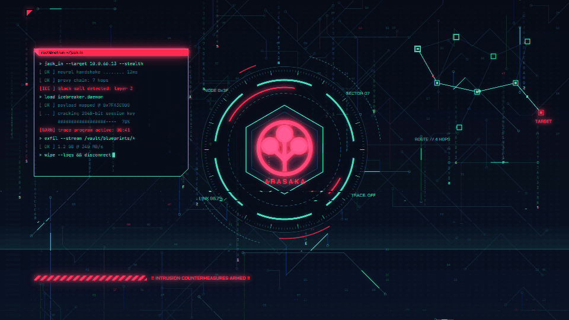
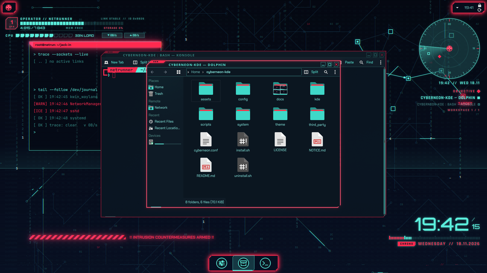
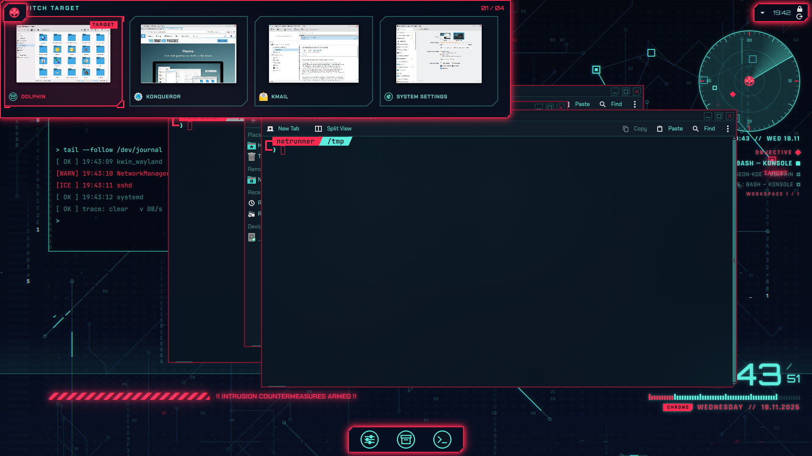
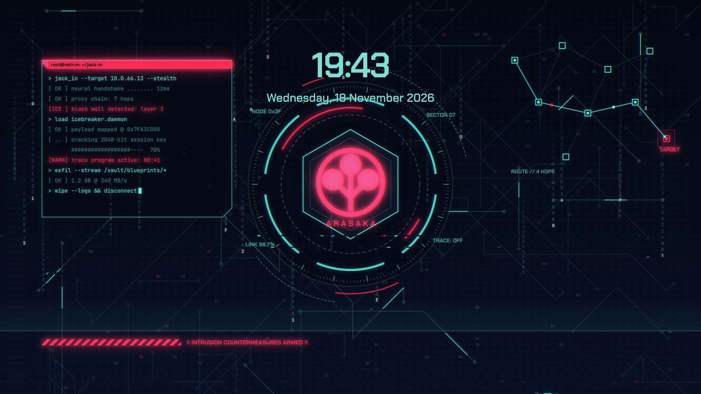
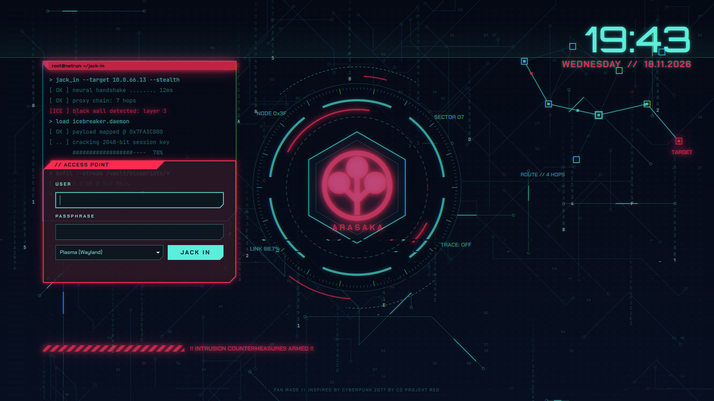
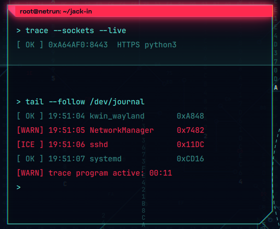

# CyberNeon — tema "netrunner" per KDE Plasma 6 (X11 e Wayland)

> ## ⚠ Fan made — tutto il merito a CD PROJEKT RED
> **CyberNeon è un progetto FAN MADE, realizzato da un grandissimo fan di _Cyberpunk 2077_ e di CD PROJEKT RED.**
> È **ispirato a _Cyberpunk 2077_ di CD PROJEKT RED**: l'universo, lo stile e l'atmosfera a cui si ispira sono **opera di CD PROJEKT RED**.
> _Cyberpunk 2077_, Arasaka e tutti i nomi, i loghi e i marchi collegati **appartengono a CD PROJEKT S.A.**
> Progetto **non ufficiale** e **non commerciale**: non è affiliato, sponsorizzato né approvato da CD PROJEKT RED.
> L'unico elemento di CD PROJEKT RED incluso è il **logo Arasaka** (`assets/logo/`), usato come omaggio fan made: resta di CD PROJEKT S.A. (vedi [Crediti](#crediti-marchi-e-licenze) e [`NOTICE.md`](NOTICE.md)).


<sub>Screenshot reale di Plasma 6.8 (laboratorio Docker del repo, <a href="#laboratorio-test-senza-un-pc-kde">vedi sotto</a>).
Nel laboratorio l'utente si chiama "netrunner": sul tuo PC il Biomonitor mostra il tuo nome.</sub>


<sub>L'HUD in movimento: fotogrammi reali catturati nel laboratorio (circa uno ogni mezzo secondo): radar, Chrono, grafici e sfondo.</sub>

Questa è l'edizione **KDE Plasma 6** di CyberNeon (**Wayland** e **X11**). Non è una copia dell'edizione Budgie: usa tutto quello
che Plasma permette e ridisegna il desktop come un **HUD da videogioco**, con la stessa palette (blu notte, rosso neon, ciano).
L'unica cosa identica a Budgie è lo **sfondo animato**.



<sub>Lo sfondo animato (render reale del componente QML). È lo stesso dell'edizione Budgie, ma disegnato dalla GPU a ogni
fotogramma dello schermo; gira anche dietro al login, alla splash e al blocco schermo.</sub>

> **Stato**: provata su **Plasma 6.8.3** (Arch Linux) nel laboratorio Docker del repo, con screenshot reali di ogni parte.
> Su altre distribuzioni con Plasma 6 dovrebbe comportarsi allo stesso modo; se qualcosa non torna, vedi
> [Primo avvio e verifica](#primo-avvio-e-verifica).

| | |
|---|---|
|  **Cornici con alone neon** e app Qt in vetro sfocato |  **Glitch GPU** all'apertura di una finestra (rallentato) |
|  **Alt+Tab "target lock"** con anteprime dal vivo (strumento di anteprima di KWin, finestre d'esempio, mostrato in alto) |  **Notifiche** in basso a sinistra, come chiamate olografiche |
|  **Blocco schermo** sullo sfondo animato |  **Splash "jack-in"**: il sigillo dello sfondo si accende |
|  **Login SDDM**: terminale d'accesso sullo sfondo animato |  **Lanciatore** a schermo intero sfocato, ricerca ad angoli tagliati |

---

## Indice

- [L'HUD: quattro zone come nel gioco](#lhud-quattro-zone-come-nel-gioco)
- [L'HUD reagisce al tuo PC](#lhud-reagisce-al-tuo-pc)
- [Cosa include](#cosa-include)
- [Requisiti](#requisiti)
- [Installazione](#installazione)
- [Configurazione (`cyberneon.conf`)](#configurazione-cyberneonconf)
- [Cosa fa `install.sh`](#cosa-fa-installsh)
- [Schermata di login (SDDM) e GRUB](#schermata-di-login-sddm-e-grub)
- [Primo avvio e verifica](#primo-avvio-e-verifica)
- [Laboratorio: test senza un PC KDE](#laboratorio-test-senza-un-pc-kde)
- [Disinstallazione](#disinstallazione)
- [Struttura del repository](#struttura-del-repository)
- [Personalizzazione](#personalizzazione)
- [Note tecniche](#note-tecniche)
- [Crediti, marchi e licenze](#crediti-marchi-e-licenze)

---

## L'HUD: quattro zone come nel gioco

Le analisi UX dell'HUD di *Cyberpunk 2077* (vedi [Crediti](#crediti-marchi-e-licenze)) lo descrivono diviso in **zone fisse**: in alto a
sinistra salute, livello ed esperienza; in alto a destra la minimappa con l'ora e, sotto, la missione attiva. CyberNeon riprende
questa **organizzazione** con elementi **disegnati da zero** che mostrano **dati veri del PC**. Nessun asset, font o grafica del gioco.

| Zona | Nel gioco (struttura) | Su CyberNeon |
|---|---|---|
| **In alto a sinistra** | salute, livello, risorse | pannello fluttuante col **logo** (apre le app) e i desktop virtuali; widget **Biomonitor**: badge "livello" = ore di accensione, barra a segmenti = **RAM libera** (con MB liberi/totali), blocchi = **CPU libera**, linea = **disco**, rete ▼▲, nome dell'operatore |
| **In alto a destra** | minimappa con l'ora, missione attiva | pannello fluttuante con area di notifica, orologio, blocco/uscita; widget **Radar**: orologio a radar (il fascio ruota coi secondi, rombo rosso = ore, quadrato ciano = minuti, logo al centro) e **tracker degli obiettivi**: la finestra attiva è l'obiettivo, le altre aperte sono i sotto-obiettivi, più il numero del workspace |
| **In basso al centro** | slot delle abilità | **dock** fluttuante a misura delle icone, con gli slot ad angoli tagliati (attivo = piastra ciano con tacca) |
| **In basso a destra** | contatore munizioni | widget **Chrono**: l'ora come "contatore", i secondi rimasti come riserva e **60 tacche** che si svuotano a ogni minuto (le ultime dieci in rosso), glitch RGB ogni 12 s (ogni 2,5 s in allerta) |
| **In basso a sinistra** | messaggi e chiamate | le **notifiche** compaiono qui, in vetro con bordo rosso |

## L'HUD reagisce al tuo PC


<sub>Modalità allerta con un vero carico sulla CPU: fotogrammi reali del laboratorio.</sub>

| | |
|---|---|
|  **Modalità allerta**: bordo del Biomonitor che pulsa, bordi dello schermo rossi, allarme dello sfondo acceso |  **Terminale live** con indirizzi offuscati e avviso `trace program active` |
|  **OSD "Quickhack"** per volume, luminosità e altri messaggi di sistema |  **CELL CHARGE**, risparmio animazioni e profilo del TUXEDO Control Center (batteria e Control Center simulati nel laboratorio) |

- **Modalità allerta.** Se CPU o RAM superano l'85% (o CPU/GPU i 95 °C) per 3 secondi, il Biomonitor pulsa in rosso e scrive cosa è
  in sovraccarico, sullo sfondo lampeggia `INTRUSION COUNTERMEASURES ARMED`, i glitch diventano frequenti e le finestre si aprono con
  un glitch più forte e più lungo. Finisce dopo 6 secondi di carico tornato basso. La RAM non conta la cache, e i lampeggi restano
  sotto i 2 al secondo. Soglie in `cyberneon.conf`.
- **Terminale live.** Il terminale dello sfondo mostra connessioni di rete e attività recente del journal, con lo stesso aspetto di
  prima. Se il traffico supera 5 MB/s compare `[WARN] trace program active` con il tempo trascorso.
  **Privacy:** gli indirizzi diventano etichette che cambiano a ogni avvio e i messaggi del journal non vengono mai mostrati (solo
  ora, gravità e nome del programma). I nomi dei programmi restano leggibili, anche negli screenshot: se non li vuoi,
  `LIVE_TERMINAL="no"`. Sul blocco schermo, sul login e nella splash non compare nessun dato reale.
- **OSD Quickhack.** Volume, microfono, luminosità, retroilluminazione tastiera, layout, touchpad, Wi-Fi, Bluetooth e profilo
  energetico compaiono come una barra di upload sopra la dock, al posto dell'OSD di Plasma. La barra vive nel Biomonitor: se togli
  quel widget, imposta `CYBER_OSD="no"` e rilancia `install.sh` per riavere l'OSD di Plasma.
- **Suoni (facoltativi, `SOUND_FX="yes"`).** Un piccolo tema audio sintetico generato da Python: chirp basso sulle notifiche (rispetta
  "Non disturbare"), avviso all'ingresso in allerta, jack-in all'avvio della sessione. Il login SDDM resta muto: lì il server audio
  dell'utente non è ancora attivo, quindi il jack-in parte subito dopo l'accesso.
- **Batteria.** Sui portatili compare **CELL CHARGE**. A batteria sotto il 20%, sfondo e radar smettono di animarsi e il terminale
  smette di aggiornarsi, finché non ricarichi.
- **TUXEDO Control Center.** Solo dove il Control Center è in esecuzione, la riga di stato del Biomonitor mostra il **profilo attivo**
  (in sola lettura). Altrove non compare nulla e non viene fatto nient'altro.

## Cosa include

| Componente | Descrizione |
|---|---|
| **Sfondo animato `CyberNeon Live`** | Identico all'edizione Budgie: linea di scansione, archi che ruotano attorno al sigillo, nodi che lampeggiano e bersaglio che pulsa, pacchetti di dati, colonne esadecimali, glitch con strisce dello sfondo spostate. Un unico componente QML (`kde/shared/CyberNeonLive.qml`) usato da sfondo, login, splash e blocco schermo. Disattivabile (`ANIMATED_WALLPAPER="no"`). |
| **Cornici delle finestre (QML)** | Barra del titolo scura dentro un **tubo neon rosso** (taglio a 45° grande in alto a sinistra, piccolo in basso a destra) con un **vero alone sfocato dalla GPU** attorno alla finestra; linguetta rossa con i tre quadratini HUD, titolo ciano maiuscolo, pulsanti ad angolo tagliato che si illuminano. Quando la finestra prende il focus l'alone **si accende con un flicker** e un'**onda ciano** attraversa la barra. |
| **Pannelli e popup in vetro** | Pannelli **fluttuanti** e menu, popup e notifiche in **vetro sfocato** con angoli tagliati e **alone neon** (disegnato da KWin come ombra, segue anche i tagli a 45°). Pulsanti, campi e selezioni delle liste di Plasma ad angoli tagliati. |
| **Widget HUD** | **Biomonitor**, **Radar + tracker degli obiettivi**, **Chrono** (vedi sopra), tutti con bagliore GPU. |
| **HUD reattivo** | Modalità allerta, terminale live, OSD Quickhack, suoni facoltativi, batteria e profilo TUXEDO ([dettagli](#lhud-reagisce-al-tuo-pc)). |
| **Glitch delle finestre (shader GLSL)** | Effetto KWin con un **fragment shader**: all'apertura e alla chiusura la finestra si sdoppia in rosso/ciano, si spezza in strisce spostate, con scanline e lampi ciano, e si ricompone in ~0,4 s. Se gli shader non sono disponibili ripiega su flicker + scatto laterale. |
| **Alt+Tab "target lock"** | Selettore di finestre con **anteprime dal vivo** in schede ad angoli tagliati; la finestra scelta ha il "lock" rosso (cornice spessa, staffe agli angoli, etichetta TARGET). |
| **App Qt in vetro (Kvantum)** | Dolphin, Impostazioni e le altre app Qt con sfondo **semitrasparente sfocato**, pulsanti e campi ad angoli tagliati, menu rossi, barre a strisce. Konsole sfocata e semitrasparente. |
| **Splash, login, blocco schermo** | Splash "**// JACKING IN**" in cui il sigillo dello sfondo animato si "accende"; login SDDM con un terminale d'accesso in vetro e alone sullo sfondo animato; blocco schermo di Plasma sullo sfondo animato, stilizzato dal tema. |
| **Icone, cursori, font, prompt, GTK, GRUB** | Come nell'edizione Budgie: icone cerchiate + Papirus-Dark con cartelle "cyber", cursori HUD, Chakra Petch / Rajdhani / Orbitron, prompt bash rosso/ciano, tema GTK, tema GRUB. |

## Requisiti

- **KDE Plasma 6** (KDE neon, Kubuntu, Fedora KDE, Arch, openSUSE…), sessione **Wayland** o **X11**, con **OpenGL** (per alone,
  sfocature e shader; qualsiasi scheda video degli ultimi anni).
- `python3` con **Pillow** e **pycairo**, `curl`; consigliati **kvantum** (app Qt in vetro), **kdeplasma-addons** (Application
  Dashboard per il lanciatore col logo) e **JetBrainsMono Nerd Font** (prompt e sfondo).

  ```bash
  sudo apt install python3-pil python3-cairo curl qt6-style-kvantum kdeplasma-addons-data   # Debian/Ubuntu/Kubuntu/neon
  sudo dnf install python3-pillow python3-cairo curl kvantum kdeplasma-addons               # Fedora
  sudo pacman -S python-pillow python-cairo curl kvantum kdeplasma-addons                   # Arch
  ```
  (i nomi dei pacchetti cambiano un po' tra distribuzioni). Senza Kvantum le app Qt usano Breeze con i colori CyberNeon
  e Dolphin diventa trasparente con una regola di KWin; senza kdeplasma-addons il lanciatore usa Kicker o Kickoff.
- Per l'HUD reattivo: `busctl` (systemd) per l'OSD Quickhack, `ss` (iproute2) per il terminale live, `pw-play` o `paplay` per i suoni.
  Se manca `busctl` resta l'OSD di Plasma.
- Per il tema GRUB: `grub-mkfont` (o `grub2-mkfont`). Prima installazione: Internet per Papirus (~33 MB).

## Installazione

```bash
git clone <url-di-questo-repo> cyberneon-kde
cd cyberneon-kde
./install.sh
```

| Opzione | Effetto |
|---|---|
| `--no-layout` | non tocca pannelli e widget (applica temi, colori, icone, cursori, font, cornici, effetti, Kvantum, Konsole, prompt) |
| `--skip-papirus` | non scarica Papirus |
| `-h` | aiuto |

> ⚠ Senza `--no-layout` i pannelli attuali vengono sostituiti dall'HUD CyberNeon (la configurazione precedente è nel backup:
> `uninstall.sh` la ripristina). Dopo l'installazione conviene fare **logout e login**.

## Configurazione (`cyberneon.conf`)

| Variabile | Default | Significato |
|---|---|---|
| `LOGO` | `assets/logo/arasaka-logo.webp` | logo al centro dello sfondo, sul badge del lanciatore e al centro del radar (tinto rosso neon). Il logo Arasaka incluso è di CD PROJEKT S.A.; vuoto = stemma originale CyberNeon |
| `LABEL` | `A R A S A K A` | scritta sotto il sigillo dello sfondo |
| `HUD_LABEL` | *(vuoto)* | nome dell'operatore nel Biomonitor; vuoto = nome utente in maiuscolo |
| `WALLPAPER` | `cyberneon-arasaka-red.png` | file creato in `~/Pictures/Wallpapers` |
| `DECORATION` | `qml` | cornici: `qml` (alone neon, animazioni) o `svg` (Aurorae SVG, più semplice) |
| `ANIMATED_WALLPAPER` | `yes` | sfondo animato (anche sul blocco schermo) o immagine statica (`no`) |
| `GLITCH_EFFECT` | `yes` | glitch GPU all'apertura/chiusura delle finestre |
| `REACTIVE_HUD` | `yes` | modalità allerta in base al carico reale |
| `ALERT_CPU`, `ALERT_RAM`, `ALERT_TEMP` | `85`, `85`, `95` | soglie dell'allerta: % CPU, % RAM (cache esclusa), °C di CPU/GPU |
| `LIVE_TERMINAL` | `yes` | dati reali e offuscati nel terminale dello sfondo |
| `TRACE_MBPS` | `5` | MB/s di traffico oltre cui compare `trace program active` |
| `CYBER_OSD` | `yes` | OSD Quickhack al posto di quello di Plasma |
| `SOUND_FX` | `no` | tema audio sintetico e jack-in all'avvio della sessione |
| `LOW_POWER_PERCENT` | `20` | a batteria sotto questa soglia le animazioni si fermano (`0` = mai) |
| `DOLPHIN_OPACITY` | `90` | opacità di Dolphin (regola KWin) usata **solo senza Kvantum** |
| `PINNED` | impostazioni, file manager, browser, Konsole, LibreOffice Calc | app nella dock (sintassi di Plasma) |
| `UI_FONT`, `FIXED_FONT`, `TITLE_FONT` | Chakra Petch 10 / JetBrainsMono Nerd Font 10 / Chakra Petch Bold 10 | font |

## Cosa fa `install.sh`

1. **Controlli** (Plasma 6, strumenti, Python) e larghezza logica dello schermo principale (`kscreen-doctor`).
2. **Backup** in `~/.local/share/cyberneon/backups/<data-ora>/` di `kdeglobals`, `kwinrc`, `kwinrulesrc`, `plasmarc`,
   `plasmashellrc`, `plasma-org.kde.plasma.desktop-appletsrc`, `kcminputrc`, `konsolerc`, `ksplashrc`, `kscreenlockerrc`,
   `plasmanotifyrc`, impostazioni GTK, `Kvantum/kvantum.kvconfig` e `~/.bashrc` (la prima volta anche in `backups/pristine/`).
3. **Font**, **Papirus**, **tema GTK** (da `third_party/Pocillo-dark`), **icone**, **cursori**.
4. **Sfondo** (senza il raccordo per i pannelli di Budgie) e asset di login/GRUB.
5. **Temi KDE**: schema colori, tema Plasma in vetro con alone, cornici QML (copiate in `~/.local/share/kwin/decorations/`).
6. **Kvantum** (se installato): tema `CyberNeon` con finestre in vetro sfocato.
7. **Sfondo animato**, **tema globale + splash**, **blocco schermo** sullo sfondo animato, **Alt+Tab** (`~/.local/share/kwin/tabbox/cyberneon`),
   **glitch GPU** (caricato subito via D-Bus), sfocatura e contrasto di KWin attivi.
8. **Konsole**, impostazioni **GTK**, **prompt** bash; regola di trasparenza per Dolphin solo senza Kvantum.
9. **Widget HUD** (`kpackagetool6`), notifiche in basso a sinistra, **OSD Quickhack** (disattiva quello di Plasma in `plasmarc`),
   script di supporto in `~/.local/share/cyberneon/bin` e, con `SOUND_FX="yes"`, tema audio in `~/.local/share/sounds/cyberneon`.
10. **Layout HUD** (`kde/layout.js`): i tre pannelli fluttuanti, sfondo, Biomonitor, Radar e Chrono; pannelli in vetro.
11. **Ricarica** di KWin e riavvio di plasmashell.

## Schermata di login (SDDM) e GRUB

```bash
sudo bash system/install-sddm.sh                          # tema SDDM con lo sfondo animato
sudo bash system/install-grub.sh                          # tema GRUB (menu visibile 5 secondi)
```

`install-sddm.sh` copia il tema in `/usr/share/sddm/themes/cyberneon` (con lo sfondo animato e il tuo sfondo), cursori e font, e scrive
`/etc/sddm.conf.d/10-cyberneon.conf` (annulla: `sudo rm /etc/sddm.conf.d/10-cyberneon.conf`). Anteprima senza cambiare niente:
`sddm-greeter-qt6 --test-mode --theme /usr/share/sddm/themes/cyberneon`.
`install-grub.sh` installa il tema in `/boot/grub/themes/cyberneon`, imposta `GRUB_THEME`, `GRUB_TIMEOUT_STYLE=menu`,
`GRUB_TIMEOUT=5` e lancia `update-grub` (su Fedora/openSUSE poi `sudo grub2-mkconfig -o /boot/grub2/grub.cfg`).
Annulla: `sudo cp /etc/default/grub.bak-cyberneon /etc/default/grub` e rigenera la configurazione.

## Primo avvio e verifica

1. `./install.sh` termina e `layout.js` stampa `panels <id> <id> <id>`;
2. in alto a sinistra il logo e il Biomonitor, in alto a destra notifiche/orologio e il radar, la dock in basso, il Chrono in basso a destra;
3. lo sfondo si muove (scansione, archi, rete) e ogni tanto fa un glitch;
4. le finestre hanno l'alone rosso; cliccandole l'alone si riaccende con un flicker;
5. apri e chiudi una finestra: glitch rosso/ciano;
6. Alt+Tab: schede con anteprime e "TARGET" rosso sulla finestra scelta;
7. blocco schermo (Meta+L): lo sfondo animato è anche lì, con il terminale originale e nessun dato reale;
8. cambia il volume: sopra la dock compare la barra Quickhack;
9. con un carico pesante (per esempio una compilazione) dopo qualche secondo parte la modalità allerta.

Errori: `journalctl --user -b | grep -iE "cyberneon|qml"`. Per vedere gli errori dei widget QML in un terminale serve
`QT_FORCE_STDERR_LOGGING=1`.

## Laboratorio: test senza un PC KDE

`lab/` contiene un ambiente Docker con **Arch Linux + Plasma 6** che gira senza schermo (KWin in modalità virtuale con
OpenGL sul nodo di rendering della GPU del PC). Esegue il vero `install.sh` e salva screenshot reali in `lab/out/`:

```bash
bash lab/run-lab.sh     # serve Docker (utente nel gruppo docker); la prima volta scarica ~2 GB
```

Produce: `02-cyberneon-desktop.png` (+ fotogrammi in `gif/`), `03-cyberneon-windows.png`, `07-glitch-open.png` (animazioni
rallentate 12 volte), `08-alttab.png` (strumento di anteprima ufficiale di KWin, con finestre d'esempio), `06-launcher-menu.png`,
`09-notification.png`, `10-lockscreen.png`, `05-splash.png`, `04-sddm-test.png`, più `install.log`, `effects.txt` (effetti caricati),
`qmllint.txt` e `plasmashell-errors.txt`. Il tuo sistema non viene toccato.

`bash lab/run-lab.sh reactive` prova solo l'HUD reattivo: traffico reale da un secondo container, carico reale sulla CPU, batteria e
TUXEDO Control Center **simulati** su un bus privato, journal di prova con un testo segreto che non deve mai comparire. I risultati
sono in `alert.txt`, `mocks.txt`, `reactive.txt` e negli screenshot `11`–`24`.

## Disinstallazione

```bash
./uninstall.sh          # ripristina la configurazione KDE/GTK di prima e rimuove i file CyberNeon
./uninstall.sh --purge  # rimuove anche i font CyberNeon e Papirus
```

## Struttura del repository

```
cyberneon-kde/
├── install.sh / uninstall.sh      installazione e ripristino
├── cyberneon.conf                 configurazione
├── kde/
│   ├── shared/                    sfondo animato (CyberNeonLive.qml), stato di carico e batteria, impostazioni QML
│   ├── bin/                       script di supporto: bus, terminale live, suoni, TUXEDO Control Center
│   ├── layout.js                  layout HUD: pannelli, widget, sfondo (Plasma scripting)
│   ├── decoration/cyberneon/      cornici delle finestre in QML (alone neon, animazioni)
│   ├── wallpaper/                 plugin dello sfondo animato
│   ├── lookandfeel/               tema globale + splash "jack-in"
│   ├── effects/cyberneon_glitch/  glitch GPU (JavaScript + shader GLSL in contents/shaders)
│   ├── tabbox/cyberneon/          Alt+Tab "target lock"
│   ├── plasmoids/                 widget HUD: biomonitor, radar, chrono
│   ├── konsole/                   palette e profilo Konsole
│   └── sddm/cyberneon/            tema SDDM (Qt 6)
├── scripts/
│   ├── make_kde_themes.py         tema Plasma (vetro, alone, angoli tagliati) + cornici SVG + schema colori
│   ├── make_kvantum.py            tema Kvantum (app Qt in vetro)
│   ├── build_theme.py             tema GTK
│   ├── make_sounds.py             tema audio sintetico (solo libreria standard)
│   ├── make_icons.py, make_logo_icon.py, make_cursors.py, make_wallpaper.py, make_system_assets.py
│   └── install_fonts.sh, install_papirus.sh
├── lab/                           laboratorio Docker (Dockerfile, run-lab.sh, inside.sh)
├── theme/, config/, system/       CSS GTK, prompt, SDDM/GRUB
├── third_party/Pocillo-dark/      base del tema GTK (GPL-2.0)
├── assets/fonts, assets/logo      font (OFL) e logo Arasaka (© CD PROJEKT S.A.)
└── docs/                          screenshot e GIF
```

## Personalizzazione

- **Palette**: rosso neon `#ff2a4f`, ciano `#5beedc`, blu `#0b1620`/`#111e29` — costanti in testa a `make_kde_themes.py`,
  `make_kvantum.py`, ai file QML e ai CSS GTK.
- **Sfondo animato**: velocità e oggetti in `kde/shared/CyberNeonLive.qml` (coordinate dello sfondo 3840×2160).
- **Cornici**: `pad` (ampiezza dell'alone), `titleH`, `cut`, colori e animazione di accensione in testa a
  `kde/decoration/cyberneon/contents/ui/main.qml`.
- **Glitch**: intensità nello shader `kde/effects/cyberneon_glitch/contents/shaders/glitch_core.frag`, durate in `contents/code/main.js`.
- **Widget HUD**: `kde/plasmoids/org.cyberneon.*/contents/ui/main.qml`; posizioni in `kde/layout.js`.
- **Allerta**: tempi di ingresso e uscita in `kde/shared/CyberNeonReactor.qml`, effetti in `kde/shared/CyberNeonLive.qml`.
- **Suoni**: `scripts/make_sounds.py`.
- **Vetro e alone di pannelli/popup**: `glass_frame()` e `glow_shadow()` in `make_kde_themes.py`.

## Note tecniche

Cose verificate nel laboratorio:
- **Alone delle finestre**: le decorazioni QML hanno un'area `padding` che KWin trasforma nell'**ombra** della finestra; l'alone è
  disegnato lì con `MultiEffect` (sfocatura GPU). Non è cliccabile e sparisce sulle finestre massimizzate.
- **Alone di pannelli e popup**: elementi `shadow-*` del tema Plasma (PNG generati con la sfocatura) con `shadow-hint-*-margin`
  più piccoli dei riquadri, così l'ombra entra di qualche pixel sotto la finestra e segue anche i tagli a 45°. La sfocatura
  dietro al vetro usa gli elementi `mask-*` (stessa forma, angoli tagliati compresi).
- **Shader negli effetti JavaScript di KWin**: si caricano con `effect.addFragmentShader(Effect.MapTexture | Effect.Modulate, "file.frag")`
  (metodo dell'oggetto `effect`, non una funzione globale) dalla cartella `contents/shaders/`, e si animano con
  `{type: Effect.ShaderUniform, fragmentShader: id, uniform: "nome"}`. Con OpenGL core serve `#version 140`; c'è anche la versione 1.10.
- **Pannelli fluttuanti sullo stesso bordo**: con `lengthMode = "fit"` e allineamenti diversi possono stare in due sulla stessa riga.
- **Widget**: una proprietà chiamata `left` in un `PlasmoidItem` blocca il widget ("Cannot override FINAL property").
- **Alt+Tab**: il selettore si prova senza tastiera con `/usr/lib/kwin-tabbox-preview <percorso>/contents/ui/main.qml`.
- **Blocco schermo e OSD** in Plasma 6.8 non si personalizzano più dal tema globale: il blocco schermo usa il plugin dello sfondo
  (quindi è animato) e il tema Plasma per campi e pulsanti.
- **OSD personalizzato**: con `[OSD] Enabled=false` in `plasmarc` Plasma non mostra l'OSD ma smette anche di emettere i segnali
  `osdProgress`/`osdText`. Le **chiamate** a `org.kde.osdService` però continuano ad arrivare e si leggono con `busctl --user monitor`.
  QML non ha processi in streaming: `cn-bus-watch` lavora a long poll, con due attese sfalsate per non perdere eventi.
- **Finestre OSD dai widget**: un `PlasmaCore.Dialog` senza `visualParent` torna nella posizione predefinita quando viene rimostrato;
  ancorato a un punto del desktop resta al suo posto.
- **Effetti KWin in JavaScript**: `effect.readConfig` legge solo le chiavi dichiarate in `contents/config/main.xml`.
- **Nomi in QML**: una proprietà `onQualcosa` viene scambiata per un gestore di segnale e `state` è già di `Item`: entrambi danno
  valori sbagliati senza alcun errore.
- `kpackagetool6` rifiuta i pacchetti `KWin/Decoration`: la decorazione viene **copiata** in `~/.local/share/kwin/decorations/`.
- Gli effetti KWin copiati con KWin già avviato si caricano al login successivo: l'installer li carica subito via D-Bus.

## Crediti, marchi e licenze

**CD PROJEKT RED / _Cyberpunk 2077_: fan made, con tutto il rispetto**
- CyberNeon è un progetto **FAN MADE**, realizzato da **un grandissimo fan di _Cyberpunk 2077_ e di CD PROJEKT RED**, come
  omaggio al loro lavoro.
- È **ispirato a _Cyberpunk 2077_ di CD PROJEKT RED**: l'immaginario netrunner, i colori rosso/ciano, le interfacce angolari e
  l'atmosfera sono **creazioni di CD PROJEKT RED**.
- *Cyberpunk 2077*, *Arasaka*, *Night City* e tutti i nomi, loghi e marchi collegati sono **marchi registrati e/o opere protette di
  CD PROJEKT S.A.** e appartengono a loro.
- Progetto **non ufficiale**: **non è affiliato, sponsorizzato né approvato** da CD PROJEKT RED o CD PROJEKT S.A.
- Sfondo, icone, cursori, stemma, widget e cornici sono **disegnati da zero via codice**. L'unico elemento di CD PROJEKT RED
  incluso è il **logo Arasaka** (`assets/logo/arasaka-logo.webp`), insieme al nome in `LABEL`: sono **di CD PROJEKT S.A.**, usati
  come omaggio fan made e non coperti dalla licenza del repository (vedi le
  [linee guida per i contenuti dei fan di CD PROJEKT RED](https://www.cdprojektred.com/en/fan-content)).
- Uso **esclusivamente non commerciale**. Se ti piace questo tema, gioca e supporta *Cyberpunk 2077* di CD PROJEKT RED.
- Se CD PROJEKT RED chiede modifiche o la rimozione di qualcosa, verrà fatto subito.

**Componenti di terze parti**
- **Pocillo-dark** (Ubuntu Budgie, pacchetto `ubuntu-budgie-themes` 0.19.0, GPL-2.0): incluso in `third_party/` con licenza e
  copyright; il tema GTK generato è un'opera derivata GPL-2.0.
- **Papirus icon theme** (GPL-3.0): scaricato durante l'installazione, non incluso.
- **Chakra Petch**, **Rajdhani**, **Orbitron**: SIL Open Font License 1.1, inclusi con le licenze.
- **KDE Plasma**, **KWin/Aurorae**, **Konsole**, **Dolphin**, **SDDM**: usati, non modificati.

**Licenza di questo repository**: GPL-2.0 (vedi `LICENSE`), salvo i componenti di terze parti e i marchi indicati sopra.

---

<sub><b>Fan made</b> da un grandissimo fan di <i>Cyberpunk 2077</i>. CyberNeon è un progetto non ufficiale e non commerciale,
ispirato a <i>Cyberpunk 2077</i> di <b>CD PROJEKT RED</b>. <i>Cyberpunk 2077</i>, Arasaka e tutti i nomi, loghi e marchi collegati
appartengono a <b>CD PROJEKT S.A.</b> Questo progetto non è affiliato, sponsorizzato né approvato da CD PROJEKT RED.</sub>

### Riferimenti per la disposizione dell'HUD

La divisione in zone dell'HUD di CyberNeon KDE si basa su queste analisi pubbliche dell'interfaccia di *Cyberpunk 2077*
(design e HUD originali: **CD PROJEKT RED**). CyberNeon ne riprende solo l'organizzazione, con grafica disegnata da zero:
- [A UX analysis of Cyberpunk 2077's HUD (Medium / Super Jump)](https://medium.com/super-jump/a-ux-analysis-of-cyberpunk-2077s-hud-f74afe6b9961)
- [Cyberpunk 2077 UX/UI critique (Interface In Game)](https://interfaceingame.com/articles/cyberpunk-2077-ux-ui-critique)
- [Cyberpunk 2077 UX analysis (trashbox.ru)](https://trashbox.ru/link/cyberpunk-2077-ux-analysis)
- [Cyberpunk 2077 (HUDS+GUIS)](https://www.hudsandguis.com/home/2019/cyberpunk-2077)
